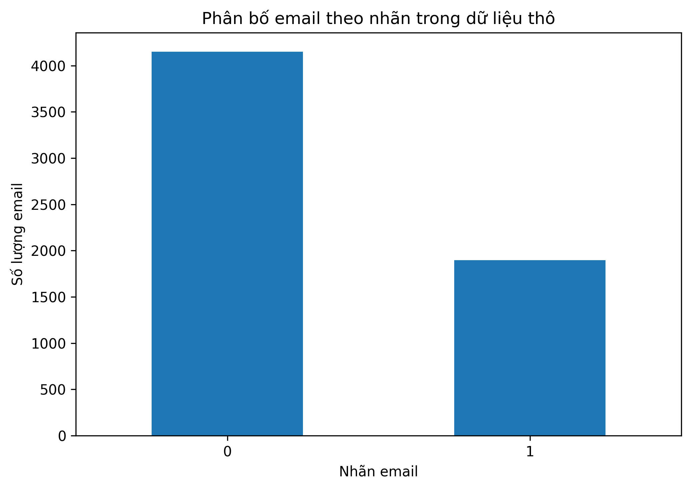
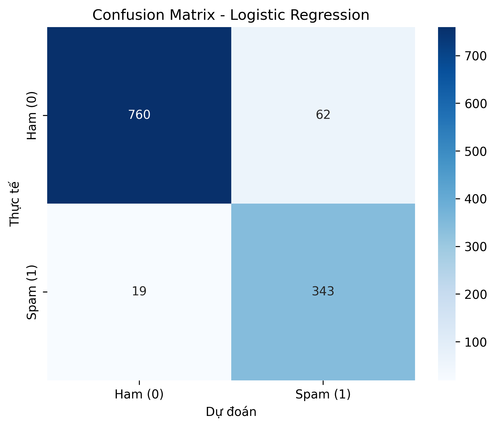
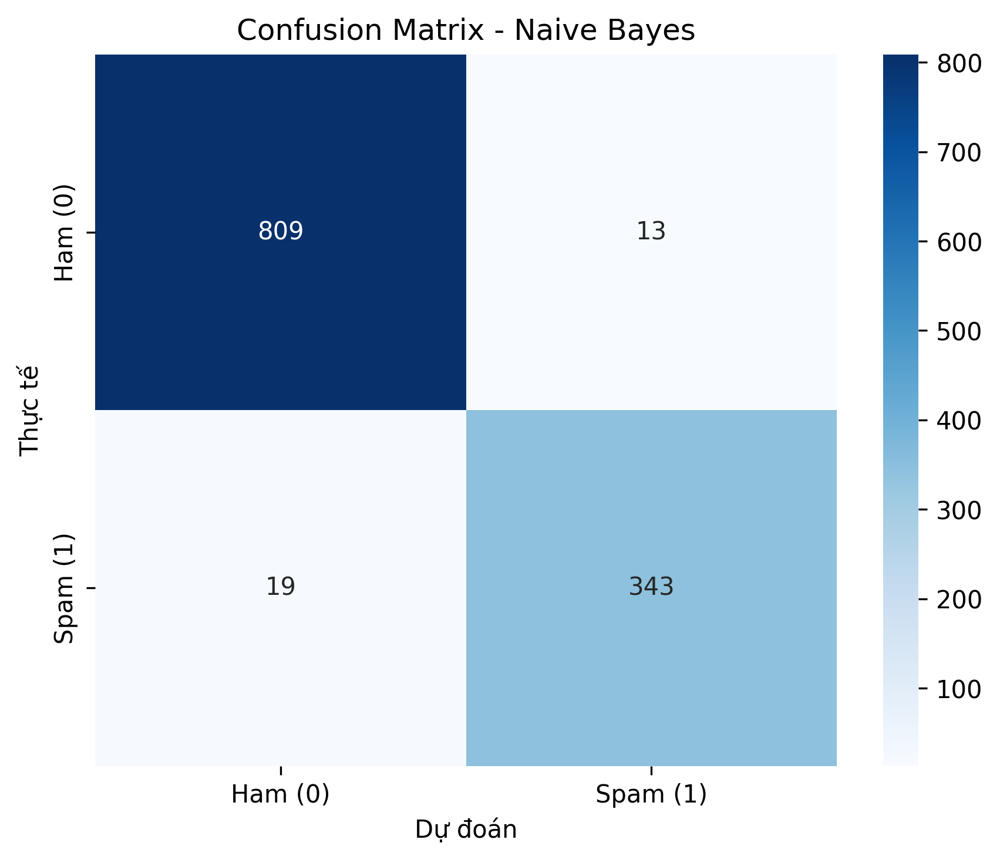
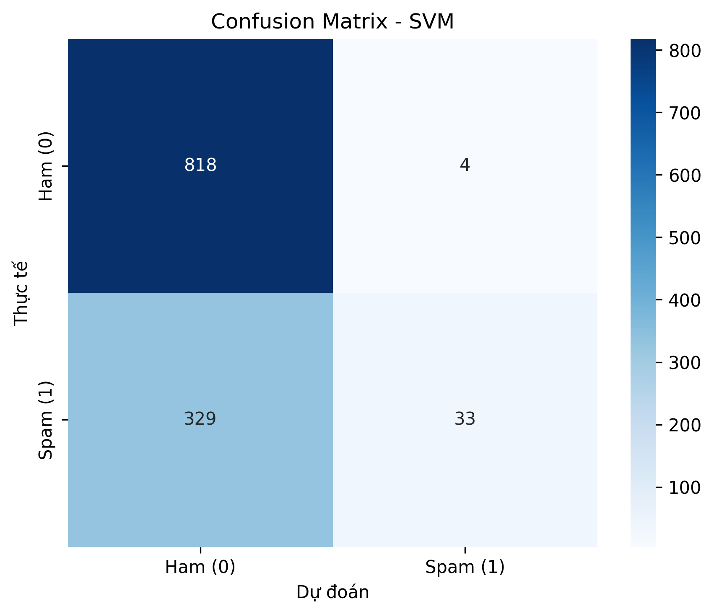
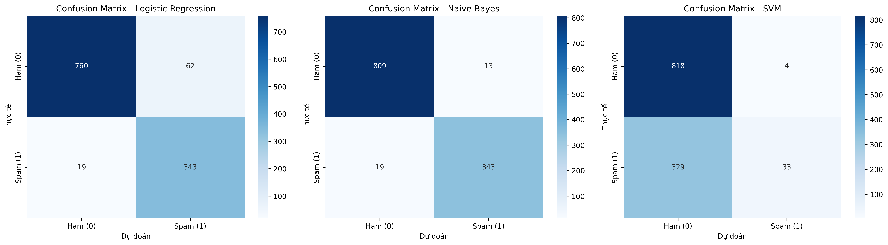

# LAB01 — Báo cáo mô tả hệ thống phân loại Email Spam

## 1. Mục tiêu

Xây dựng chương trình phân loại nội dung email thành hai lớp:

- **Ham (0):** Email bình thường.
- **Spam (1):** Email rác.

Dự án thực hiện khám phá dữ liệu, làm sạch văn bản, biểu diễn văn bản bằng TF-IDF, chia dữ liệu thành tập Train/Test, huấn luyện ba mô hình Machine Learning, đánh giá bằng các chỉ số phân loại và trực quan hóa ma trận nhầm lẫn.

Ba thuật toán được sử dụng gồm Logistic Regression, Naive Bayes và Support Vector Machine (SVM). Các thuật toán được triển khai trong `src/model.py`.

## 2. Cấu trúc và thành phần

| Thành phần | Vai trò |
|---|---|
| `data/raw/SpamAssassin.csv` | Dữ liệu đầu vào gồm các cột `label`, `data`, `filename` |
| `src/eda.py` | Thống kê dữ liệu, phân bố nhãn và độ dài email |
| `src/preprocess.py` | Làm sạch văn bản, chia dữ liệu và tạo đặc trưng TF-IDF |
| `src/model.py` | Cài đặt Logistic Regression, Naive Bayes và SVM |
| `src/train.py` | Huấn luyện ba mô hình và lưu mô hình |
| `src/evaluate.py` | Tính các chỉ số đánh giá, xuất bảng CSV và vẽ confusion matrix |
| `src/predict.py` | Nạp vectorizer và mô hình để dự đoán email nhập từ terminal |
| `src/pipeline.py` | Điều phối toàn bộ quy trình tiền xử lý, huấn luyện và đánh giá |
| `config.yaml` | Lưu cấu hình thực nghiệm được các thành phần hỗ trợ sử dụng |
| `notebooks/lab01.ipynb` | Notebook trình bày quy trình và kết quả thực nghiệm |
| `reports/` | Lưu bảng metrics và các kết quả đánh giá |
| `docs/images/` | Lưu biểu đồ phân bố nhãn và ma trận nhầm lẫn |

## 3. Dữ liệu

Dữ liệu ban đầu được lưu trong tệp `data/raw/SpamAssassin.csv`, gồm 6.046 dòng và 3 cột. Kiểm tra ban đầu cho thấy dữ liệu không có giá trị thiếu hoặc dòng trùng lặp hoàn toàn theo tất cả các cột.

Phân bố nhãn ban đầu:

| Nhãn | Ý nghĩa | Số email |
|---:|---|---:|
| 0 | Ham | 4.150 |
| 1 | Spam | 1.896 |
| **Tổng** | | **6.046** |

Trong bước tiền xử lý, chương trình loại bỏ các dòng thiếu `label` hoặc `data`, loại trùng theo cặp `(label, data)`, làm sạch nội dung và loại bỏ email rỗng sau khi làm sạch.

Theo kết quả tiền xử lý của lần thực nghiệm này, dữ liệu còn **5.920 email**, bao gồm:

- 4.110 email Ham.
- 1.810 email Spam.



## 4. Luồng xử lý hệ thống

Quy trình xử lý dữ liệu được thực hiện theo các bước sau:

```text
SpamAssassin.csv
       |
       v
Kiểm tra dữ liệu, loại dòng thiếu và trùng
       |
       v
Làm sạch nội dung email
(chữ thường, bỏ HTML/URL, chuẩn hóa văn bản)
       |
       v
Chia Train/Test theo tỷ lệ 80/20
(stratify theo nhãn)
       |
       v
TF-IDF: fit trên Train, transform trên Test
       |
       +-------------------+
       |                   |
       v                   v
    Tập Train           Tập Test
       |
       v
Huấn luyện 3 mô hình
(Logistic Regression, Naive Bayes, SVM)
       |
       v
Lưu mô hình và đánh giá trên Train/Test
       |
       v
Bảng Metrics và Confusion Matrix
       |
       v
Dự đoán email mới
```

### 4.1. Làm sạch văn bản

Hàm `clean_text()` trong `src/preprocess.py` thực hiện các thao tác:

1. Chuyển nội dung email thành chữ thường.
2. Loại bỏ thẻ HTML.
3. Loại bỏ URL dạng `http...` và `www...`.
4. Chỉ giữ lại chữ cái tiếng Anh `a-z` và khoảng trắng.
5. Chuẩn hóa các khoảng trắng liên tiếp.

Sau đó, chương trình loại bỏ email rỗng và các email trùng nhau theo nội dung cùng nhãn.

### 4.2. Chia Train/Test và TF-IDF

Các thiết lập chính của lần thực nghiệm:

- Tỷ lệ Train/Test: **80%/20%**.
- `random_state=42` để hỗ trợ tái lập kết quả chia dữ liệu.
- `stratify=y` nhằm duy trì tỷ lệ nhãn giữa hai tập.
- Sử dụng TF-IDF với `max_features=10000`, `ngram_range=(1, 2)` và `stop_words="english"` theo cấu hình hiện tại.

Các giá trị TF-IDF được cấu hình trong `config.yaml` cần thống nhất với tham số mà `src/preprocess.py` thực sự đọc và sử dụng. Các tham số chia dữ liệu như `test_size`, `random_state` hoặc `stratify` chỉ được xem là cấu hình từ file nếu mã nguồn thực sự đọc chúng từ file đó.

Vectorizer chỉ được `fit` trên tập Train và sử dụng `transform` trên tập Test. Cách thực hiện này hạn chế rò rỉ thông tin từ tập Test vào quá trình xây dựng đặc trưng.

Với 5.920 email sau tiền xử lý, số lượng mẫu được chia như sau:

| Tập dữ liệu | Số lượng email |
|---|---:|
| Train | 4.736 |
| Test | 1.184 |
| **Tổng** | **5.920** |

Số đặc trưng TF-IDF tối đa được cấu hình là 10.000. Số đặc trưng thực tế có thể thấp hơn, phụ thuộc vào từ vựng xuất hiện trong tập Train.

Các tệp được tạo trong quá trình tiền xử lý:

- `data/processed/X_train.pkl`
- `data/processed/X_test.pkl`
- `data/processed/y_train.pkl`
- `data/processed/y_test.pkl`
- `models/tfidf_vectorizer.pkl`

### 4.3. Các mô hình

#### Logistic Regression

- Được cài đặt thủ công bằng NumPy.
- Sử dụng hàm sigmoid và Gradient Descent để cập nhật trọng số.
- `learning_rate=0.1`.
- `n_iterations=1000`.
- Hàm `predict()` sử dụng ngưỡng phân loại 0.3 thay vì ngưỡng mặc định 0.5.

Ngưỡng thấp hơn có thể giúp tăng Recall, nhưng đồng thời có thể làm tăng số lượng False Positive.

#### Naive Bayes

- Được cài đặt thủ công trong `src/model.py`.
- Tính xác suất tiên nghiệm, trung bình và phương sai theo từng lớp, sau đó so sánh log-posterior để đưa ra dự đoán.
- Theo cách triển khai hiện tại, đây là biến thể Gaussian Naive Bayes.

#### Support Vector Machine (SVM)

- Được cài đặt thủ công bằng trọng số, bias và hinge loss.
- Chuyển nhãn từ `{0, 1}` sang `{-1, 1}` trong quá trình huấn luyện.
- Các tham số thực nghiệm hiện tại gồm `learning_rate=0.01`, `lambda_param=0.01` và `n_iterations=100`.

Cần bảo đảm các giá trị được mô tả trong báo cáo khớp với cấu hình thực sự được sử dụng khi huấn luyện. Nếu tham số được khai báo trực tiếp trong mã nguồn thay vì đọc từ `config.yaml`, cần đối chiếu với mã nguồn tương ứng.

Các mô hình được lưu tại:

- `models/model_lr.pkl`
- `models/model_nb.pkl`
- `models/model_svm.pkl`

Các tệp này được tạo trong quá trình huấn luyện và không nhất thiết có sẵn trong bản ZIP của dự án.

## 5. Phương pháp đánh giá

Chương trình `src/evaluate.py` tính toán các chỉ số trên cả tập Train và Test.

- **Accuracy:** Tỷ lệ dự đoán đúng trên tổng số mẫu.
- **Precision:** Trong các email được dự đoán là Spam, tỷ lệ thực sự thuộc lớp Spam.
- **Recall:** Trong các email Spam thực tế, tỷ lệ được phát hiện đúng.
- **F1-score:** Trung bình điều hòa giữa Precision và Recall.
- **TPR (True Positive Rate):** Tỷ lệ phát hiện đúng email Spam; trong bài toán này bằng Recall.
- **FPR (False Positive Rate):** Tỷ lệ email Ham bị phân loại nhầm thành Spam.

Các thành phần của ma trận nhầm lẫn:

| Ký hiệu | Ý nghĩa |
|---|---|
| TN | Email Ham được dự đoán đúng là Ham |
| FP | Email Ham bị dự đoán nhầm là Spam |
| FN | Email Spam bị dự đoán nhầm là Ham |
| TP | Email Spam được dự đoán đúng là Spam |

Các chỉ số này được sử dụng để đánh giá độ chính xác tổng thể, khả năng phát hiện Spam và mức độ phân loại nhầm email bình thường.

## 6. Kết quả thực nghiệm

Các bảng dưới đây sử dụng số liệu thực nghiệm đã cung cấp cho cả Train và Test.

### 6.1. Kết quả trên tập Test

| Mô hình | Accuracy | Precision | Recall / TPR | F1-score | FPR |
|---|---:|---:|---:|---:|---:|
| Logistic Regression | 93.16% | 84.69% | 94.75% | 89.44% | 7.54% |
| Naive Bayes | **97.30%** | **96.35%** | 94.75% | **95.54%** | 1.58% |
| SVM | 71.88% | 89.19% | 9.12% | 16.54% | **0.49%** |

Kết quả cho thấy Naive Bayes đạt Accuracy, Precision và F1-score cao nhất trên tập Test. Logistic Regression có Recall bằng Naive Bayes nhưng Precision thấp hơn. SVM có FPR thấp nhất, tuy nhiên Recall rất thấp nên bỏ sót nhiều email Spam.

### 6.2. Ma trận nhầm lẫn

Trong các ma trận dưới đây, hàng biểu thị nhãn thực tế và cột biểu thị nhãn dự đoán. Thứ tự nhãn là Ham (0), Spam (1).

#### Logistic Regression



| Nhãn thực tế | Dự đoán Ham | Dự đoán Spam |
|---|---:|---:|
| Ham | TN = 760 | FP = 62 |
| Spam | FN = 19 | TP = 343 |

Trên tập Test, Logistic Regression phân loại đúng 760 email Ham và 343 email Spam. Mô hình bỏ sót 19 email Spam, tương ứng Recall 94.75%. Tuy nhiên, có 62 email Ham bị phân loại nhầm thành Spam, khiến FPR đạt 7.54%.

#### Naive Bayes



| Nhãn thực tế | Dự đoán Ham | Dự đoán Spam |
|---|---:|---:|
| Ham | TN = 809 | FP = 13 |
| Spam | FN = 19 | TP = 343 |

Naive Bayes phân loại đúng 809 email Ham và 343 email Spam trên tập Test. Mô hình chỉ có 13 False Positive và 19 False Negative. Với F1-score 95.54% và FPR 1.58%, Naive Bayes cho thấy khả năng cân bằng tốt giữa việc phát hiện Spam và hạn chế cảnh báo nhầm.

#### SVM



| Nhãn thực tế | Dự đoán Ham | Dự đoán Spam |
|---|---:|---:|
| Ham | TN = 818 | FP = 4 |
| Spam | FN = 329 | TP = 33 |

SVM phân loại đúng 818 email Ham nhưng chỉ phát hiện đúng 33 email Spam. Mô hình bỏ sót 329 email Spam, dẫn đến Recall chỉ đạt 9.12% và F1-score đạt 16.54%.

Mặc dù FPR chỉ đạt 0.49%, kết quả này không đồng nghĩa với việc mô hình phân loại Spam hiệu quả. Nguyên nhân là mô hình dự đoán rất ít email thuộc lớp Spam, khiến số lượng email Ham bị báo nhầm thấp nhưng số lượng Spam bị bỏ sót lại rất cao.

#### Ma trận nhầm lẫn tổng hợp



Các hình ảnh ma trận nhầm lẫn được tạo trong quá trình đánh giá. Nếu tên hoặc đường dẫn hình ảnh trong môi trường thực tế khác với tài liệu, cần cập nhật lại liên kết tương ứng.

### 6.3. Kết quả trên tập Train

| Mô hình | Accuracy | Precision | Recall / TPR | F1-score | FPR |
|---|---:|---:|---:|---:|---:|
| Logistic Regression | 95.35% | 90.08% | 95.30% | 92.62% | 4.62% |
| Naive Bayes | **99.62%** | **98.97%** | **99.79%** | **99.38%** | **0.46%** |
| SVM | 71.94% | 88.89% | 9.39% | 16.99% | 0.52% |

Naive Bayes đạt kết quả cao nhất trên tập Train và vẫn duy trì hiệu suất tốt trên tập Test. Chênh lệch giữa hai tập cho thấy hiệu suất trên dữ liệu huấn luyện cao hơn dữ liệu chưa thấy; do đó, cần tiếp tục theo dõi khả năng tổng quát hóa của mô hình.

Logistic Regression có các chỉ số Train và Test tương đối tốt, mặc dù Precision và Accuracy trên Test thấp hơn Train.

SVM có Accuracy và Recall thấp trên cả hai tập dữ liệu. Điều này gợi ý rằng cấu hình hoặc quá trình tối ưu hiện tại chưa giúp mô hình học hiệu quả đặc trưng phân biệt email Spam và Ham.

### 6.4. Tổng hợp tiêu chí tốt nhất

- **F1-score cao nhất trên Train:** Naive Bayes — 0.9938.
- **FPR thấp nhất trên Train:** Naive Bayes — 0.0046.
- **F1-score cao nhất trên Test:** Naive Bayes — 0.9554.
- **FPR thấp nhất trên Test:** SVM — 0.0049.

Mặc dù SVM có FPR thấp nhất trên Test, mô hình bỏ sót 329 email Spam. Vì vậy, cần đánh giá kết hợp nhiều chỉ số thay vì lựa chọn mô hình chỉ dựa vào FPR.

## 7. Nhận xét và lựa chọn mô hình

Dựa trên các kết quả thực nghiệm, có thể đưa ra những nhận xét sau.

### Logistic Regression

Mô hình đạt Recall 94.75% trên tập Test, bằng Naive Bayes. Điều này cho thấy khả năng phát hiện email Spam khá tốt. Tuy nhiên, Precision chỉ đạt 84.69%, FPR đạt 7.54% và có 62 email Ham bị phân loại nhầm thành Spam.

Mô hình phù hợp khi ưu tiên phát hiện nhiều email Spam nhưng cần cân nhắc nguy cơ cảnh báo nhầm.

### Naive Bayes

Mô hình đạt Accuracy 97.30%, Precision 96.35%, Recall 94.75% và F1-score 95.54% trên tập Test. So với Logistic Regression, mô hình có cùng Recall nhưng giảm số False Positive từ 62 xuống 13.

Đây là lựa chọn phù hợp khi cần cân bằng giữa phát hiện Spam và hạn chế email bình thường bị đánh dấu nhầm.

### SVM

Mô hình có FPR thấp nhất, ở mức 0.49%, nhưng Recall chỉ đạt 9.12%. Với 329 email Spam bị bỏ sót trên tập Test, SVM chưa đáp ứng tốt mục tiêu phát hiện Spam trong cấu hình hiện tại.

Cần kiểm tra cách tối ưu, số vòng lặp, tốc độ hội tụ, cách cập nhật trọng số và cách triển khai trước khi đánh giá lại.

### Cân nhắc giữa False Positive và False Negative

Đối với hệ thống lọc Spam, việc lựa chọn mô hình cần dựa trên chi phí của hai loại lỗi:

- **False Negative (FN):** Email Spam lọt vào hộp thư bình thường.
- **False Positive (FP):** Email bình thường bị chuyển nhầm vào thư mục Spam.

Nếu ưu tiên phát hiện nhiều email Spam, cần quan tâm đến Recall. Nếu cần hạn chế cảnh báo nhầm, cần chú trọng Precision và FPR. F1-score hỗ trợ đánh giá sự cân bằng giữa Precision và Recall.

Với kết quả hiện tại, **Naive Bayes là mô hình được đề xuất**, do đạt F1-score và Accuracy cao nhất trên tập Test, đồng thời có Precision cao và FPR thấp.

## 8. Cách cài đặt và chạy

Thực hiện các lệnh tại thư mục gốc của dự án.

### 8.1. Tạo môi trường ảo

```bash
python -m venv .venv
```

Kích hoạt môi trường trên Windows PowerShell:

```powershell
.\.venv\Scripts\Activate.ps1
```

Trên macOS/Linux/Git Bash:

```bash
source .venv/bin/activate
```

### 8.2. Cài đặt thư viện

```bash
python -m pip install --upgrade pip
pip install -r requirements.txt
```

### 8.3. Chạy toàn bộ pipeline

```bash
python src/pipeline.py
```

Pipeline thực hiện tiền xử lý dữ liệu, tạo đặc trưng TF-IDF, huấn luyện ba mô hình và đánh giá kết quả.

Nếu các tệp dữ liệu đã xử lý tồn tại và tương thích, có thể bỏ qua tiền xử lý:

```bash
python src/pipeline.py --skip-preprocess
```

Nếu các tệp mô hình đã tồn tại, có thể bỏ qua cả tiền xử lý và huấn luyện:

```bash
python src/pipeline.py --skip-preprocess --skip-train
```

Chỉ sử dụng các tùy chọn này khi các tệp đầu vào tương ứng đã tồn tại và phù hợp với cấu hình đang dùng.

### 8.4. Dự đoán email mới

Sau khi pipeline tạo vectorizer và các mô hình, chạy:

```bash
python src/predict.py
```

Nhập nội dung email để nhận dự đoán. Nhập `exit` để thoát.

Notebook báo cáo nằm tại `notebooks/lab01.ipynb`.

## 9. Hạn chế và hướng phát triển

1. **Cải thiện SVM:** Kiểm tra quá trình hội tụ, điều chỉnh số vòng lặp, rà soát cách cập nhật trọng số và so sánh với một triển khai tham chiếu để xác minh kết quả.

2. **Điều chỉnh ngưỡng phân loại:** Đánh giá các ngưỡng khác nhau cho Logistic Regression trên tập validation, không lựa chọn ngưỡng dựa trên kết quả của tập Test.

3. **Đồng bộ tiền xử lý:** Đưa bước làm sạch và vector hóa vào một pipeline thống nhất nhằm hạn chế sai khác giữa lúc huấn luyện và dự đoán. Đặc biệt, cần bảo đảm logic làm sạch trong `predict.py` khớp với `preprocess.py`.

4. **Phân tích lỗi:** Kiểm tra các trường hợp FP và FN để xác định những dạng email dễ bị phân loại sai.

5. **Đánh giá độ ổn định:** Cân nhắc sử dụng đánh giá chéo và kiểm tra kết quả trên các tập dữ liệu khác nhau.

6. **Tăng khả năng tái lập:** Ghim phiên bản thư viện trong `requirements.txt`, quản lý tham số tập trung và cập nhật báo cáo sau mỗi lần chạy pipeline.

## 10. Kết luận

Dự án đã xây dựng được quy trình phân loại email Spam và Ham từ dữ liệu thô đến tiền xử lý văn bản, biểu diễn đặc trưng bằng TF-IDF, huấn luyện ba thuật toán và đánh giá bằng nhiều chỉ số phân loại. Dữ liệu sau tiền xử lý gồm 5.920 email, được chia thành 4.736 mẫu Train và 1.184 mẫu Test theo tỷ lệ 80/20.

Kết quả thực nghiệm cho thấy **Naive Bayes đạt hiệu suất tốt nhất trên tập Test**, với Accuracy 97.30%, Precision 96.35%, Recall 94.75% và F1-score 95.54%. Mô hình có FPR 1.58%, với 13 email Ham bị phân loại nhầm thành Spam và 19 email Spam bị bỏ sót. Đây là kết quả cho thấy sự cân bằng tốt giữa khả năng phát hiện Spam và hạn chế cảnh báo nhầm.

Logistic Regression đạt Accuracy 93.16%, Recall 94.75% và F1-score 89.44%. Mặc dù khả năng phát hiện Spam tương đương Naive Bayes về Recall, mô hình có Precision thấp hơn và số False Positive cao hơn, với 62 email Ham bị phân loại nhầm thành Spam.

Trong khi đó, SVM đạt Accuracy 71.88%, Recall 9.12% và F1-score 16.54% trên tập Test. Mặc dù FPR chỉ đạt 0.49%, mô hình bỏ sót 329 email Spam, cho thấy hiệu suất phát hiện Spam còn hạn chế trong cấu hình hiện tại. Vì vậy, cần tiếp tục kiểm tra và cải thiện cách triển khai cũng như quá trình tối ưu mô hình.

Nhìn chung, Naive Bayes là mô hình được đề xuất cho hệ thống phân loại email Spam trong lần thực nghiệm này. Tuy nhiên, kết quả chỉ phản ánh bộ dữ liệu và cấu hình hiện tại, nên cần được đánh giá thêm trước khi áp dụng vào môi trường thực tế.

Các bảng số liệu, tham số mô hình và hình ảnh báo cáo cần được đồng bộ với kết quả của lần chạy cuối cùng. Nên thực hiện **Run All** từ đầu đến cuối trong notebook hoặc chạy `python src/pipeline.py`, sau đó kiểm tra lại bảng metrics và các ma trận nhầm lẫn để bảo đảm tính nhất quán của báo cáo.