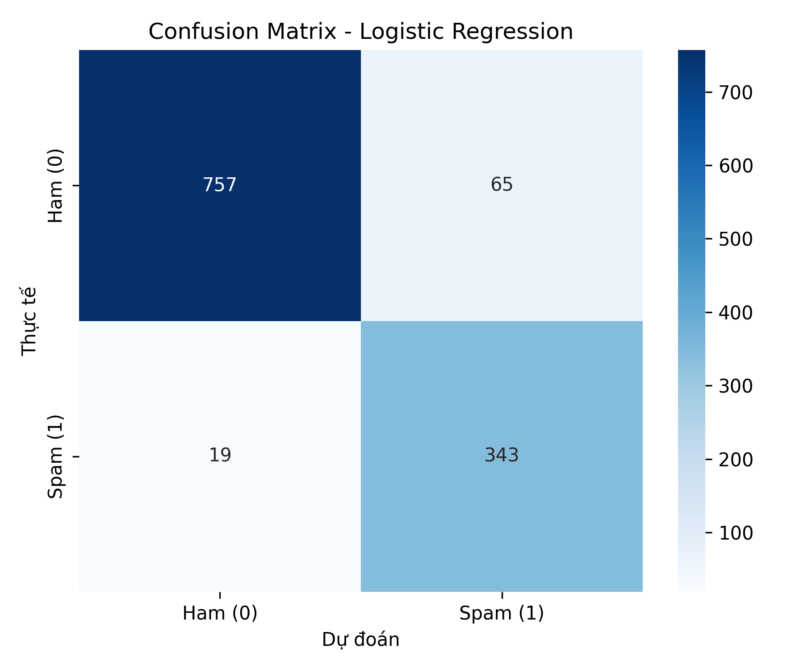
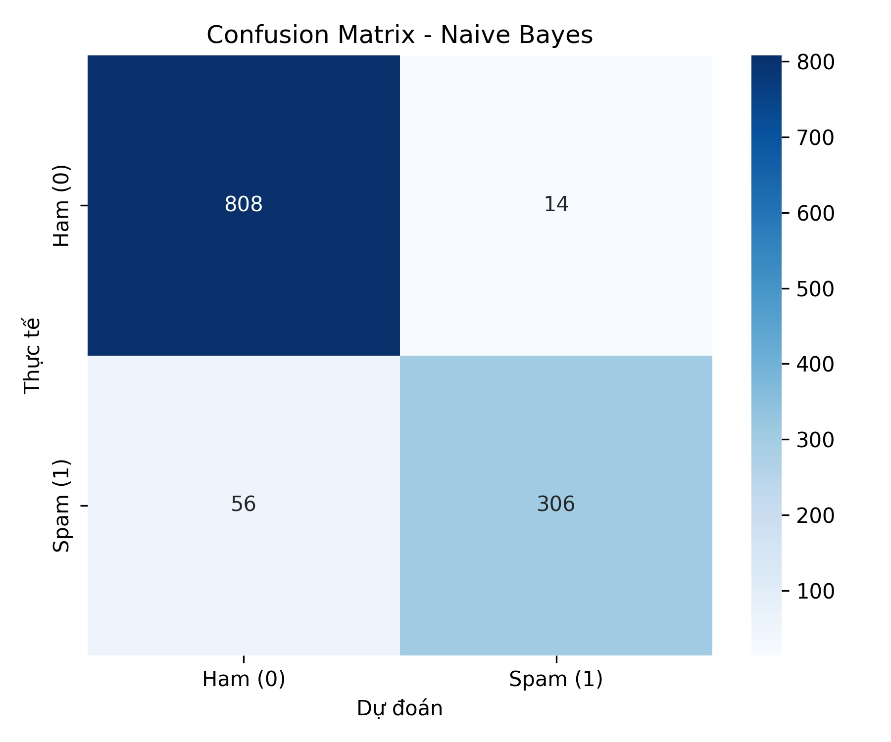
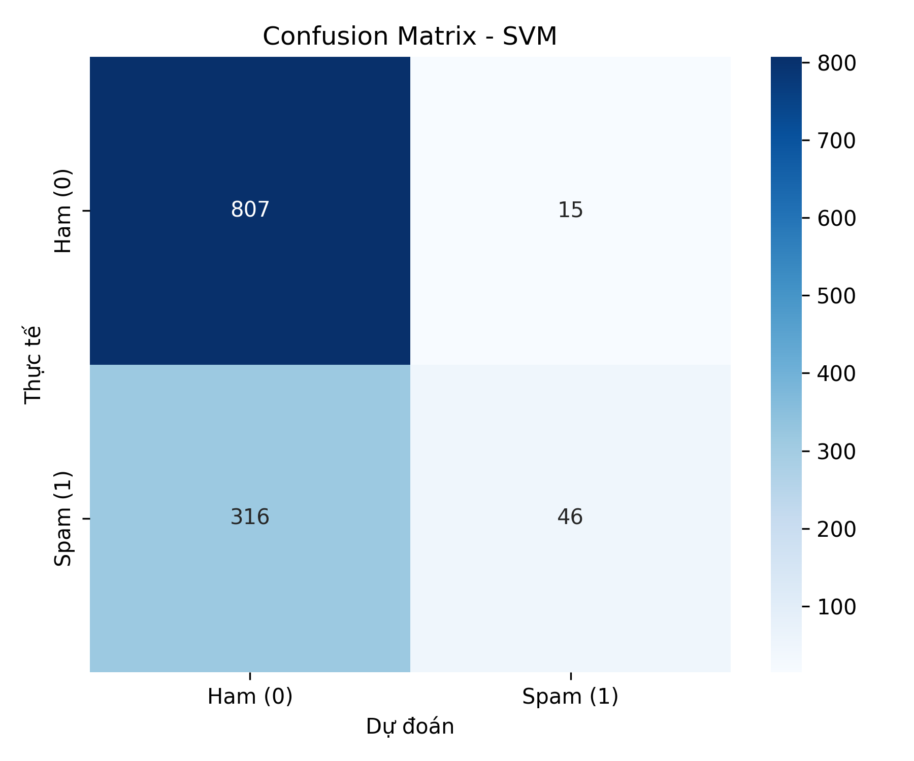
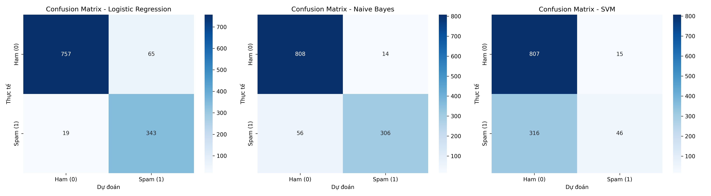

# LAB01 — Báo cáo mô tả hệ thống phân loại Email Spam

## 1. Mục tiêu

Xây dựng chương trình phân loại nội dung email thành hai lớp:

- **Ham (0):** email bình thường.
- **Spam (1):** email rác.

Dự án thực hiện khám phá dữ liệu, làm sạch văn bản, biểu diễn văn bản bằng TF-IDF, chia tập Train/Test, huấn luyện ba mô hình được cài đặt trong `src/model.py`, đánh giá bằng các chỉ số phân loại và lưu hình ảnh minh họa.

## 2. Cấu trúc và thành phần

| Thành phần | Vai trò |
|---|---|
| `data/raw/SpamAssassin.csv` | Dữ liệu đầu vào, gồm các cột `label`, `data`, `filename` |
| `src/eda.py` | Thống kê dữ liệu, phân bố nhãn và độ dài email |
| `src/preprocess.py` | Làm sạch văn bản, chia dữ liệu, tạo TF-IDF và lưu dữ liệu đã xử lý |
| `src/model.py` | Cài đặt Logistic Regression, Naive Bayes và SVM |
| `src/train.py` | Huấn luyện ba mô hình và lưu bằng joblib |
| `src/evaluate.py` | Tính metrics, xuất bảng CSV và vẽ confusion matrix |
| `src/predict.py` | Nạp vectorizer/mô hình để dự đoán email nhập từ terminal |
| `src/pipeline.py` | Điều phối tiền xử lý → huấn luyện → đánh giá |
| `notebooks/lab01.ipynb` | Notebook trình bày quy trình và kết quả |
| `reports/` | Bảng metrics và hình ảnh đánh giá |

## 3. Dữ liệu

Tệp dữ liệu gốc có **6.046 dòng và 3 cột**. Kiểm tra ban đầu cho thấy không có giá trị thiếu hoặc dòng trùng lặp hoàn toàn theo toàn bộ cột trong tệp gốc.

Phân bố nhãn ban đầu:

| Nhãn | Ý nghĩa | Số email |
|---:|---|---:|
| 0 | Ham | 4.150 |
| 1 | Spam | 1.896 |
| **Tổng** | | **6.046** |

Trong bước tiền xử lý, chương trình loại bỏ các dòng thiếu `label` hoặc `data`, loại trùng theo cặp `(label, data)`, làm sạch nội dung và loại email rỗng sau làm sạch. Theo các quy tắc hiện tại, dữ liệu còn **5.920 email**: 4.110 Ham và 1.810 Spam.

## 4. Luồng xử lý hệ thống

```text
SpamAssassin.csv
       │
       ▼
Kiểm tra dữ liệu / loại dòng thiếu và trùng
       │
       ▼
Làm sạch nội dung email
(chữ thường, bỏ HTML/URL, bỏ ký tự ngoài a-z, chuẩn hóa khoảng trắng)
       │
       ▼
Chia Train/Test theo tỷ lệ 80/20, stratify theo nhãn
       │
       ▼
TF-IDF: fit trên Train, transform trên Test
(max_features=10.000, bỏ stop-words tiếng Anh)
       │
       ├───────────────┐
       ▼               ▼
   Tập Train         Tập Test
       │               │
       ▼               │
Huấn luyện 3 mô hình   │
(LR, Naive Bayes, SVM) │
       │               │
       ▼               ▼
     Lưu mô hình → Đánh giá trên Train/Test
                         │
                         ▼
           Metrics CSV + Confusion Matrix
                         │
                         ▼
              Dự đoán email mới
```

### 4.1. Làm sạch văn bản

Hàm `clean_text()` trong `src/preprocess.py` thực hiện:

1. Chuyển nội dung thành chữ thường.
2. Loại bỏ thẻ HTML.
3. Loại bỏ URL dạng `http...` và `www...`.
4. Chỉ giữ chữ cái tiếng Anh `a-z` và khoảng trắng.
5. Chuẩn hóa các khoảng trắng liên tiếp.

Sau đó, chương trình loại email rỗng và loại trùng theo nội dung cùng nhãn.

### 4.2. Chia Train/Test và TF-IDF

- Tỷ lệ Train/Test: **80% / 20%**.
- `random_state=42`.
- `stratify=y` để duy trì tỷ lệ nhãn giữa hai tập.
- `TfidfVectorizer(max_features=10000, stop_words="english")`.
- Vectorizer chỉ được `fit` trên tập Train; tập Test chỉ dùng `transform`. Cách làm này hạn chế rò rỉ thông tin từ tập Test vào quá trình xây dựng đặc trưng.

Với 5.920 email sau làm sạch, số mẫu dự kiến là **4.736 Train** và **1.184 Test**. Số đặc trưng thực tế không vượt quá 10.000 và được quyết định bởi từ vựng trong tập Train.

Các tệp dữ liệu và vectorizer được tạo khi chạy tiền xử lý:
- `data/processed/X_train.pkl`
- `data/processed/X_test.pkl`
- `data/processed/y_train.pkl`
- `data/processed/y_test.pkl`
- `models/tfidf_vectorizer.pkl`

### 4.3. Các mô hình

**Logistic Regression**
- Cài đặt thủ công bằng NumPy.
- Dùng hàm sigmoid và Gradient Descent để cập nhật trọng số.
- `learning_rate=0.1`, `n_iterations=500`.
- Hàm `predict()` hiện sử dụng ngưỡng **0.3** thay vì ngưỡng mặc định 0.5. Ngưỡng thấp hơn có thể tăng Recall nhưng cũng có thể làm tăng False Positive.

**Naive Bayes**
- Cài đặt thủ công trong `src/model.py`, tính prior, trung bình và phương sai theo lớp, sau đó so sánh log-posterior.
- Đây là biến thể Gaussian Naive Bayes theo cách triển khai hiện tại; không nên mô tả là `MultinomialNB` nếu chưa thay đổi mã nguồn.

**Support Vector Machine (SVM)**
- Cài đặt thủ công bằng trọng số, bias và hinge loss.
- Dùng nhãn chuyển từ `{0, 1}` sang `{-1, 1}` trong quá trình huấn luyện.
- Cấu hình trong `src/train.py`: `learning_rate=0.001`, `lambda_param=0.01`, `n_iterations=100`.

Mô hình được lưu tại:
- `models/model_lr.pkl`
- `models/model_nb.pkl`
- `models/model_svm.pkl`

Các tệp mô hình được sinh ra khi chạy huấn luyện; chúng không nhất thiết có sẵn trong bản ZIP.

## 5. Phương pháp đánh giá

`src/evaluate.py` tính các chỉ số trên cả Train và Test:

- **Accuracy:** tỷ lệ dự đoán đúng trên tổng số mẫu.
- **Precision:** trong các email được dự đoán là Spam, tỷ lệ thực sự là Spam.
- **Recall / TPR:** trong các email Spam thực tế, tỷ lệ được phát hiện đúng.
- **F1-score:** trung bình điều hòa của Precision và Recall.
- **FPR:** tỷ lệ email Ham bị dự đoán nhầm thành Spam.

Với ma trận nhầm lẫn nhị phân:
- **TN:** Ham dự đoán đúng là Ham.
- **FP:** Ham dự đoán nhầm là Spam.
- **FN:** Spam dự đoán nhầm là Ham.
- **TP:** Spam dự đoán đúng là Spam.

## 6. Kết quả thực nghiệm đã lưu

Các số liệu dưới đây được trích từ `reports/metrics_summary.csv` trong gói dự án. Đây là kết quả đã lưu, không phải lời khẳng định rằng pipeline vừa được chạy lại trong môi trường hiện tại.

### 6.1. So sánh trên tập Test

| Mô hình | Accuracy | Precision | Recall / TPR | F1-score | FPR |
|---|---:|---:|---:|---:|---:|
| Logistic Regression | 92.91% | 84.07% | **94.75%** | 89.09% | 7.91% |
| Naive Bayes | **94.09%** | **95.63%** | 84.53% | **89.74%** | **1.70%** |
| SVM | 72.04% | 75.41% | 12.71% | 21.75% | 1.82% |

### 6.2. Ma trận nhầm lẫn

Các ma trận dùng thứ tự hàng là nhãn thực tế và cột là nhãn dự đoán: Ham (0), Spam (1).

#### Logistic Regression



| | Dự đoán Ham | Dự đoán Spam |
|---|---:|---:|
| Thực tế Ham | TN = 757 | FP = 65 |
| Thực tế Spam | FN = 19 | TP = 343 |

Mô hình phát hiện được 343/362 email Spam trong tập Test, đạt Recall 94.75%. Đổi lại, có 65 email Ham bị báo nhầm là Spam.

#### Naive Bayes



| | Dự đoán Ham | Dự đoán Spam |
|---|---:|---:|
| Thực tế Ham | TN = 808 | FP = 14 |
| Thực tế Spam | FN = 56 | TP = 306 |

Naive Bayes có Accuracy, Precision và F1 cao nhất trong bảng kết quả đã lưu; đồng thời số False Positive thấp (14). Tuy nhiên, mô hình bỏ sót 56 email Spam, nên Recall thấp hơn Logistic Regression.

#### SVM



| | Dự đoán Ham | Dự đoán Spam |
|---|---:|---:|
| Thực tế Ham | TN = 807 | FP = 15 |
| Thực tế Spam | FN = 316 | TP = 46 |

SVM có FPR thấp nhưng chỉ phát hiện 46/362 email Spam. Recall 12.71% là thấp, vì vậy kết quả hiện tại chưa phù hợp nếu mục tiêu là phát hiện Spam. Cần xem lại cách tối ưu, số vòng lặp, tốc độ hội tụ và cách triển khai trước khi kết luận thuật toán SVM không phù hợp với bài toán.

#### Ma trận tổng hợp



### 6.3. Kết quả trên tập Train

| Mô hình | Accuracy | Precision | Recall / TPR | F1-score | FPR |
|---|---:|---:|---:|---:|---:|
| Logistic Regression | 95.27% | 89.53% | 95.72% | 92.52% | 4.93% |
| Naive Bayes | 99.47% | 98.30% | 100.00% | 99.14% | 0.76% |
| SVM | 72.87% | 81.96% | 14.43% | 24.54% | 1.40% |

Naive Bayes có chỉ số Train rất cao nhưng kết quả Test thấp hơn, nên cần theo dõi khả năng tổng quát hóa. SVM thấp trên cả Train và Test; điều này gợi ý mô hình có thể chưa được tối ưu hoặc chưa hội tụ đầy đủ.

## 7. Nhận xét và lựa chọn mô hình

Không có một mô hình tốt nhất cho mọi mục tiêu:

- Nếu ưu tiên **giảm email Spam bị bỏ sót**, Logistic Regression đang có Recall cao nhất (94.75%).
- Nếu ưu tiên **Precision, Accuracy, F1 cao và ít báo nhầm email bình thường**, Naive Bayes có kết quả tốt nhất trong bảng hiện tại.
- SVM cần được kiểm tra và cải thiện thêm trước khi sử dụng.

Với bài toán lọc spam, nên chọn ngưỡng dựa trên chi phí của hai loại lỗi: bỏ sót Spam (FN) và đánh dấu nhầm email hợp lệ (FP). Không nên chỉ dựa vào Accuracy.

## 8. Cách cài đặt và chạy

Tại thư mục gốc của dự án:

```bash
python -m venv .venv
```

Kích hoạt môi trường trên Windows PowerShell:

```powershell
.\.venv\Scripts\Activate.ps1
```

Cài thư viện:

```bash
pip install -r requirements.txt
```

Chạy toàn bộ quy trình:

```bash
python src/pipeline.py
```

Chạy dự đoán email tương tác sau khi pipeline đã tạo vectorizer và mô hình:

```bash
python src/predict.py
```

Notebook báo cáo nằm ở `notebooks/lab01.ipynb`.

## 9. Hạn chế và hướng phát triển

1. Cải thiện SVM: kiểm tra hội tụ, tăng/điều chỉnh số vòng lặp và chuẩn hóa cách cập nhật trọng số; so sánh với một triển khai tham chiếu để xác minh.
2. So sánh thêm các ngưỡng cho Logistic Regression bằng tập validation, không chọn ngưỡng dựa trên tập Test.
3. Dùng pipeline lưu cả tiền xử lý và mô hình để giảm nguy cơ sai khác giữa lúc huấn luyện và dự đoán. Hiện tại, `predict.py` có hàm làm sạch riêng; nên bảo đảm logic này luôn khớp với `preprocess.py`.
4. Cân nhắc thêm kiểm tra chất lượng dữ liệu, phân tích lỗi FP/FN và đánh giá chéo.
5. Ghim phiên bản thư viện trong `requirements.txt` để tăng khả năng tái lập kết quả.

## 10. Kết luận

Dự án đã có luồng xử lý cơ bản từ dữ liệu email thô đến vector hóa TF-IDF, huấn luyện ba thuật toán, đánh giá bằng nhiều chỉ số và trực quan hóa ma trận nhầm lẫn. Theo kết quả đang lưu, Naive Bayes có F1 cao nhất (89.74%), trong khi Logistic Regression có Recall cao nhất (94.75%). SVM cần được cải thiện do Recall thấp trên tập Test.

Các bảng và hình ảnh trong báo cáo lấy từ những tệp đang có trong `reports/`. Để tái tạo kết quả trên máy khác, cài đặt các thư viện và chạy `python src/pipeline.py`; cần lưu ý kết quả có thể khác nếu môi trường hoặc mã nguồn thay đổi.
