# BÁO CÁO THỰC NGHIỆM LAB01

## 1. Thông tin lần chạy

- Run ID: `20261105_013738_9a4527`
- Trạng thái: **SUCCESS**
- Thời gian bắt đầu: 2026-11-05T01:37:38+07:00
- Thời gian kết thúc: 2026-11-05T01:38:40+07:00

## 2. Tổng quan Pipeline

Pipeline thực hiện các giai đoạn chính:

EDA → Preprocessing → Training → Evaluation → Inference

Mỗi giai đoạn nhận dữ liệu từ bước trước, thực hiện chức năng riêng và tạo đầu ra phục vụ giai đoạn tiếp theo.

## 3. Tiến trình thực hiện

| STT | Bước thực hiện | Trạng thái |
|---:|---|---|
| 1 | EDA | SUCCESS |
| 2 | PREPROCESSING | SUCCESS |
| 3 | TRAINING - Logistic Regression | SUCCESS |
| 4 | TRAINING - Naive Bayes | SUCCESS |
| 5 | TRAINING - SVM | SUCCESS |
| 6 | TRAINING | SUCCESS |
| 7 | EVALUATION - Logistic Regression - Train | SUCCESS |
| 8 | EVALUATION - Logistic Regression - Test | SUCCESS |
| 9 | EVALUATION - Naive Bayes - Train | SUCCESS |
| 10 | EVALUATION - Naive Bayes - Test | SUCCESS |
| 11 | EVALUATION - SVM - Train | SUCCESS |
| 12 | EVALUATION - SVM - Test | SUCCESS |
| 13 | EVALUATION | SUCCESS |
| 14 | PIPELINE | SUCCESS |

## 4. Giải thích các giai đoạn

### 4.1. Exploratory Data Analysis - Phân tích dữ liệu

**Mục đích:** Khảo sát dữ liệu email ban đầu để hiểu cấu trúc, phân bố nhãn, độ dài email và phát hiện các vấn đề như dữ liệu thiếu hoặc dữ liệu bất thường.

**Input:** Tập dữ liệu email SpamAssassin ban đầu, gồm nhãn phân loại và nội dung email.

**Cách thực hiện:** Đọc dữ liệu, kiểm tra số lượng dòng và cột, kiểu dữ liệu, giá trị thiếu, dữ liệu trùng lặp, phân bố nhãn và thống kê độ dài nội dung email.

**Output:** Các thống kê mô tả và biểu đồ giúp đánh giá chất lượng dữ liệu trước khi tiền xử lý.

**Trạng thái thực tế:** SUCCESS

**Input tracking thực tế:**

```json
{
  "dataset": "C:\\ML\\lab01_ML\\data\\raw\\SpamAssassin.csv"
}
```

**Output tracking thực tế:**

```json
{
  "dataset_shape": [
    6046,
    3
  ],
  "columns": [
    "label",
    "data",
    "filename"
  ],
  "missing_values": {
    "label": 0,
    "data": 0,
    "filename": 0
  },
  "duplicate_rows": 0,
  "label_distribution": {
    "0": 4150,
    "1": 1896
  },
  "email_length_statistics": {
    "count": 6046.0,
    "mean": 1799.6660602050943,
    "std": 2079.2343754896,
    "min": 28.0,
    "25%": 661.25,
    "50%": 1133.0,
    "75%": 1932.0,
    "max": 10773.0
  },
  "saved_files": [
    "reports/label_distribution.csv",
    "docs/images/label_distribution.png"
  ],
  "saved_figures": [
    "C:\\ML\\lab01_ML\\reports\\figures\\20261105_013738_9a4527\\eda\\label_distribution.png",
    "C:\\ML\\lab01_ML\\reports\\figures\\20261105_013738_9a4527\\eda\\missing_values.png",
    "C:\\ML\\lab01_ML\\reports\\figures\\20261105_013738_9a4527\\eda\\email_length_distribution.png"
  ],
  "duration_seconds": 0.5605
}
```

### 4.2. Data Preprocessing - Tiền xử lý dữ liệu

**Mục đích:** Làm sạch dữ liệu email và chuyển nội dung văn bản thành dạng số để các thuật toán Machine Learning có thể xử lý.

**Input:** Dữ liệu email sau khi khảo sát ở giai đoạn EDA.

**Cách thực hiện:** Làm sạch nội dung, xử lý dữ liệu trùng lặp, tách dữ liệu thành tập Train và Test, sau đó sử dụng TF-IDF để biểu diễn văn bản thành vector đặc trưng.

**Output:** Dữ liệu đã làm sạch, các tập X_train, X_test, y_train, y_test và ma trận đặc trưng TF-IDF.

**Trạng thái thực tế:** SUCCESS

**Input tracking thực tế:**

```json
{
  "dataset": "C:\\ML\\lab01_ML\\data\\raw\\SpamAssassin.csv",
  "config": "C:\\ML\\lab01_ML\\config.yaml",
  "original_rows": 6046
}
```

**Output tracking thực tế:**

```json
{
  "rows_after_dropna": 6046,
  "rows_after_duplicates": 5920,
  "rows_after_cleaning": 5920,
  "train_samples": 4736,
  "test_samples": 1184,
  "train_shape": [
    4736,
    10000
  ],
  "test_shape": [
    1184,
    10000
  ],
  "tfidf_features": 10000,
  "parameters": {
    "test_size": 0.2,
    "random_state": 42,
    "max_features": 10000,
    "ngram_range": [
      1,
      2
    ]
  },
  "saved_files": [
    "data/processed/X_train.pkl",
    "data/processed/X_test.pkl",
    "data/processed/y_train.pkl",
    "data/processed/y_test.pkl",
    "data/processed/train_clean.csv",
    "data/processed/test_clean.csv",
    "models/tfidf_vectorizer.pkl"
  ],
  "saved_figures": [
    "C:\\ML\\lab01_ML\\reports\\figures\\20261105_013738_9a4527\\preprocessing\\cleaning_comparison.png",
    "C:\\ML\\lab01_ML\\reports\\figures\\20261105_013738_9a4527\\preprocessing\\preprocessing_steps.png",
    "C:\\ML\\lab01_ML\\reports\\figures\\20261105_013738_9a4527\\preprocessing\\train_test_distribution.png",
    "C:\\ML\\lab01_ML\\reports\\figures\\20261105_013738_9a4527\\preprocessing\\tfidf_sparsity.png",
    "C:\\ML\\lab01_ML\\reports\\figures\\20261105_013738_9a4527\\preprocessing\\tfidf_top_features.png"
  ],
  "duration_seconds": 3.8277
}
```

### 4.3. Model Training - Huấn luyện mô hình

**Mục đích:** Xây dựng các mô hình phân loại email Spam và Ham từ dữ liệu huấn luyện đã được vector hóa.

**Input:** X_train, y_train và cấu hình tham số của từng mô hình.

**Cách thực hiện:** Huấn luyện lần lượt Logistic Regression, Naive Bayes và Support Vector Machine. Trong quá trình huấn luyện, mỗi mô hình học các tham số từ dữ liệu Train.

**Output:** Các mô hình đã huấn luyện, tham số đã học và thời gian huấn luyện.

**Trạng thái thực tế:** SUCCESS

**Input tracking thực tế:**

```json
{
  "train_shape": [
    4736,
    10000
  ],
  "label_shape": [
    4736
  ],
  "parameters": {
    "learning_rate": 0.1,
    "n_iterations": 1000
  }
}
```

**Output tracking thực tế:**

```json
{
  "model_name": "Logistic Regression",
  "status": "TRAINED",
  "train_samples": 4736,
  "features": 10000,
  "training_time_seconds": 45.5135,
  "saved_model": "C:\\ML\\lab01_ML\\models\\model_lr.pkl"
}
```

### 4.4. Model Training - Huấn luyện mô hình

**Mục đích:** Xây dựng các mô hình phân loại email Spam và Ham từ dữ liệu huấn luyện đã được vector hóa.

**Input:** X_train, y_train và cấu hình tham số của từng mô hình.

**Cách thực hiện:** Huấn luyện lần lượt Logistic Regression, Naive Bayes và Support Vector Machine. Trong quá trình huấn luyện, mỗi mô hình học các tham số từ dữ liệu Train.

**Output:** Các mô hình đã huấn luyện, tham số đã học và thời gian huấn luyện.

**Trạng thái thực tế:** SUCCESS

**Input tracking thực tế:**

```json
{
  "train_shape": [
    4736,
    10000
  ],
  "label_shape": [
    4736
  ],
  "parameters": {}
}
```

**Output tracking thực tế:**

```json
{
  "model_name": "Naive Bayes",
  "status": "TRAINED",
  "train_samples": 4736,
  "features": 10000,
  "training_time_seconds": 0.2903,
  "saved_model": "C:\\ML\\lab01_ML\\models\\model_nb.pkl"
}
```

### 4.5. Model Training - Huấn luyện mô hình

**Mục đích:** Xây dựng các mô hình phân loại email Spam và Ham từ dữ liệu huấn luyện đã được vector hóa.

**Input:** X_train, y_train và cấu hình tham số của từng mô hình.

**Cách thực hiện:** Huấn luyện lần lượt Logistic Regression, Naive Bayes và Support Vector Machine. Trong quá trình huấn luyện, mỗi mô hình học các tham số từ dữ liệu Train.

**Output:** Các mô hình đã huấn luyện, tham số đã học và thời gian huấn luyện.

**Trạng thái thực tế:** SUCCESS

**Input tracking thực tế:**

```json
{
  "train_shape": [
    4736,
    10000
  ],
  "label_shape": [
    4736
  ],
  "parameters": {
    "learning_rate": 0.01,
    "lambda_param": 0.01,
    "n_iterations": 100
  }
}
```

**Output tracking thực tế:**

```json
{
  "model_name": "SVM",
  "status": "TRAINED",
  "train_samples": 4736,
  "features": 10000,
  "training_time_seconds": 8.0511,
  "saved_model": "C:\\ML\\lab01_ML\\models\\model_svm.pkl"
}
```

### 4.6. Model Training - Huấn luyện mô hình

**Mục đích:** Xây dựng các mô hình phân loại email Spam và Ham từ dữ liệu huấn luyện đã được vector hóa.

**Input:** X_train, y_train và cấu hình tham số của từng mô hình.

**Cách thực hiện:** Huấn luyện lần lượt Logistic Regression, Naive Bayes và Support Vector Machine. Trong quá trình huấn luyện, mỗi mô hình học các tham số từ dữ liệu Train.

**Output:** Các mô hình đã huấn luyện, tham số đã học và thời gian huấn luyện.

**Trạng thái thực tế:** SUCCESS

**Input tracking thực tế:**

```json
{
  "train_samples": 4736,
  "features": 10000,
  "models": [
    "Logistic Regression",
    "Naive Bayes",
    "SVM"
  ]
}
```

**Output tracking thực tế:**

```json
{
  "execution_times": {
    "Logistic Regression": 45.5135,
    "Naive Bayes": 0.2903,
    "SVM": 8.0511
  },
  "total_training_time": 54.3011,
  "saved_models": [
    "models/model_lr.pkl",
    "models/model_nb.pkl",
    "models/model_svm.pkl"
  ],
  "saved_figures": [
    "C:\\ML\\lab01_ML\\reports\\figures\\20261105_013738_9a4527\\training\\training_time_comparison.png",
    "C:\\ML\\lab01_ML\\reports\\figures\\20261105_013738_9a4527\\training\\training_configuration.png",
    "C:\\ML\\lab01_ML\\reports\\figures\\20261105_013738_9a4527\\training\\training_dataset_overview.png"
  ],
  "experiment_log": "docs/experiment_logs.csv"
}
```

### 4.7. Model Evaluation - Đánh giá mô hình

**Mục đích:** Đánh giá khả năng phân loại của từng mô hình trên dữ liệu kiểm tra chưa được sử dụng để huấn luyện.

**Input:** X_test, y_test và các mô hình đã huấn luyện.

**Cách thực hiện:** Dự đoán nhãn trên tập Test, sau đó tính Accuracy, Precision, Recall, F1-score, TPR, FPR và AUC. Đồng thời phân tích Confusion Matrix và ROC Curve.

**Output:** Bảng metrics, ma trận nhầm lẫn, đường ROC và kết quả so sánh giữa các mô hình.

**Trạng thái thực tế:** SUCCESS

**Input tracking thực tế:**

```json
{
  "model_name": "Logistic Regression",
  "dataset": "Train",
  "X_shape": [
    4736,
    10000
  ],
  "y_shape": [
    4736
  ],
  "samples": 4736,
  "features": 10000
}
```

**Output tracking thực tế:**

```json
{
  "Accuracy": 0.9535472972972973,
  "Precision": 0.9007832898172323,
  "Recall": 0.9530386740331491,
  "F1": 0.9261744966442953,
  "TPR": 0.9530386740331491,
  "FPR": 0.046228710462287104,
  "AUC": 0.9716361438211613,
  "TN": 3136,
  "FP": 152,
  "FN": 68,
  "TP": 1380,
  "confusion_matrix": [
    [
      3136,
      152
    ],
    [
      68,
      1380
    ]
  ],
  "evaluation_time_seconds": 0.0033
}
```

### 4.8. Model Evaluation - Đánh giá mô hình

**Mục đích:** Đánh giá khả năng phân loại của từng mô hình trên dữ liệu kiểm tra chưa được sử dụng để huấn luyện.

**Input:** X_test, y_test và các mô hình đã huấn luyện.

**Cách thực hiện:** Dự đoán nhãn trên tập Test, sau đó tính Accuracy, Precision, Recall, F1-score, TPR, FPR và AUC. Đồng thời phân tích Confusion Matrix và ROC Curve.

**Output:** Bảng metrics, ma trận nhầm lẫn, đường ROC và kết quả so sánh giữa các mô hình.

**Trạng thái thực tế:** SUCCESS

**Input tracking thực tế:**

```json
{
  "model_name": "Logistic Regression",
  "dataset": "Test",
  "X_shape": [
    1184,
    10000
  ],
  "y_shape": [
    1184
  ],
  "samples": 1184,
  "features": 10000
}
```

**Output tracking thực tế:**

```json
{
  "Accuracy": 0.9315878378378378,
  "Precision": 0.8469135802469135,
  "Recall": 0.9475138121546961,
  "F1": 0.8943937418513689,
  "TPR": 0.9475138121546961,
  "FPR": 0.07542579075425791,
  "AUC": 0.9596792622763506,
  "TN": 760,
  "FP": 62,
  "FN": 19,
  "TP": 343,
  "confusion_matrix": [
    [
      760,
      62
    ],
    [
      19,
      343
    ]
  ],
  "evaluation_time_seconds": 0.0013
}
```

### 4.9. Model Evaluation - Đánh giá mô hình

**Mục đích:** Đánh giá khả năng phân loại của từng mô hình trên dữ liệu kiểm tra chưa được sử dụng để huấn luyện.

**Input:** X_test, y_test và các mô hình đã huấn luyện.

**Cách thực hiện:** Dự đoán nhãn trên tập Test, sau đó tính Accuracy, Precision, Recall, F1-score, TPR, FPR và AUC. Đồng thời phân tích Confusion Matrix và ROC Curve.

**Output:** Bảng metrics, ma trận nhầm lẫn, đường ROC và kết quả so sánh giữa các mô hình.

**Trạng thái thực tế:** SUCCESS

**Input tracking thực tế:**

```json
{
  "model_name": "Naive Bayes",
  "dataset": "Train",
  "X_shape": [
    4736,
    10000
  ],
  "y_shape": [
    4736
  ],
  "samples": 4736,
  "features": 10000
}
```

**Output tracking thực tế:**

```json
{
  "Accuracy": 0.9961993243243243,
  "Precision": 0.9897260273972602,
  "Recall": 0.9979281767955801,
  "F1": 0.9938101788170564,
  "TPR": 0.9979281767955801,
  "FPR": 0.004562043795620438,
  "AUC": 0.9999590424244869,
  "TN": 3273,
  "FP": 15,
  "FN": 3,
  "TP": 1445,
  "confusion_matrix": [
    [
      3273,
      15
    ],
    [
      3,
      1445
    ]
  ],
  "evaluation_time_seconds": 0.6071
}
```

### 4.10. Model Evaluation - Đánh giá mô hình

**Mục đích:** Đánh giá khả năng phân loại của từng mô hình trên dữ liệu kiểm tra chưa được sử dụng để huấn luyện.

**Input:** X_test, y_test và các mô hình đã huấn luyện.

**Cách thực hiện:** Dự đoán nhãn trên tập Test, sau đó tính Accuracy, Precision, Recall, F1-score, TPR, FPR và AUC. Đồng thời phân tích Confusion Matrix và ROC Curve.

**Output:** Bảng metrics, ma trận nhầm lẫn, đường ROC và kết quả so sánh giữa các mô hình.

**Trạng thái thực tế:** SUCCESS

**Input tracking thực tế:**

```json
{
  "model_name": "Naive Bayes",
  "dataset": "Test",
  "X_shape": [
    1184,
    10000
  ],
  "y_shape": [
    1184
  ],
  "samples": 1184,
  "features": 10000
}
```

**Output tracking thực tế:**

```json
{
  "Accuracy": 0.972972972972973,
  "Precision": 0.9634831460674157,
  "Recall": 0.9475138121546961,
  "F1": 0.9554317548746517,
  "TPR": 0.9475138121546961,
  "FPR": 0.015815085158150853,
  "AUC": 0.9935476065653103,
  "TN": 809,
  "FP": 13,
  "FN": 19,
  "TP": 343,
  "confusion_matrix": [
    [
      809,
      13
    ],
    [
      19,
      343
    ]
  ],
  "evaluation_time_seconds": 0.1447
}
```

### 4.11. Model Evaluation - Đánh giá mô hình

**Mục đích:** Đánh giá khả năng phân loại của từng mô hình trên dữ liệu kiểm tra chưa được sử dụng để huấn luyện.

**Input:** X_test, y_test và các mô hình đã huấn luyện.

**Cách thực hiện:** Dự đoán nhãn trên tập Test, sau đó tính Accuracy, Precision, Recall, F1-score, TPR, FPR và AUC. Đồng thời phân tích Confusion Matrix và ROC Curve.

**Output:** Bảng metrics, ma trận nhầm lẫn, đường ROC và kết quả so sánh giữa các mô hình.

**Trạng thái thực tế:** SUCCESS

**Input tracking thực tế:**

```json
{
  "model_name": "SVM",
  "dataset": "Train",
  "X_shape": [
    4736,
    10000
  ],
  "y_shape": [
    4736
  ],
  "samples": 4736,
  "features": 10000
}
```

**Output tracking thực tế:**

```json
{
  "Accuracy": 0.7193834459459459,
  "Precision": 0.8888888888888888,
  "Recall": 0.09392265193370165,
  "F1": 0.16989381636477202,
  "TPR": 0.09392265193370165,
  "FPR": 0.005170316301703163,
  "AUC": 0.9747585813472059,
  "TN": 3271,
  "FP": 17,
  "FN": 1312,
  "TP": 136,
  "confusion_matrix": [
    [
      3271,
      17
    ],
    [
      1312,
      136
    ]
  ],
  "evaluation_time_seconds": 0.0038
}
```

### 4.12. Model Evaluation - Đánh giá mô hình

**Mục đích:** Đánh giá khả năng phân loại của từng mô hình trên dữ liệu kiểm tra chưa được sử dụng để huấn luyện.

**Input:** X_test, y_test và các mô hình đã huấn luyện.

**Cách thực hiện:** Dự đoán nhãn trên tập Test, sau đó tính Accuracy, Precision, Recall, F1-score, TPR, FPR và AUC. Đồng thời phân tích Confusion Matrix và ROC Curve.

**Output:** Bảng metrics, ma trận nhầm lẫn, đường ROC và kết quả so sánh giữa các mô hình.

**Trạng thái thực tế:** SUCCESS

**Input tracking thực tế:**

```json
{
  "model_name": "SVM",
  "dataset": "Test",
  "X_shape": [
    1184,
    10000
  ],
  "y_shape": [
    1184
  ],
  "samples": 1184,
  "features": 10000
}
```

**Output tracking thực tế:**

```json
{
  "Accuracy": 0.71875,
  "Precision": 0.8918918918918919,
  "Recall": 0.09116022099447514,
  "F1": 0.16541353383458646,
  "TPR": 0.09116022099447514,
  "FPR": 0.004866180048661801,
  "AUC": 0.9647269158903631,
  "TN": 818,
  "FP": 4,
  "FN": 329,
  "TP": 33,
  "confusion_matrix": [
    [
      818,
      4
    ],
    [
      329,
      33
    ]
  ],
  "evaluation_time_seconds": 0.0027
}
```

### 4.13. Model Evaluation - Đánh giá mô hình

**Mục đích:** Đánh giá khả năng phân loại của từng mô hình trên dữ liệu kiểm tra chưa được sử dụng để huấn luyện.

**Input:** X_test, y_test và các mô hình đã huấn luyện.

**Cách thực hiện:** Dự đoán nhãn trên tập Test, sau đó tính Accuracy, Precision, Recall, F1-score, TPR, FPR và AUC. Đồng thời phân tích Confusion Matrix và ROC Curve.

**Output:** Bảng metrics, ma trận nhầm lẫn, đường ROC và kết quả so sánh giữa các mô hình.

**Trạng thái thực tế:** SUCCESS

**Input tracking thực tế:**

```json
{
  "train_samples": 4736,
  "test_samples": 1184,
  "features": 10000,
  "models": [
    "Logistic Regression",
    "Naive Bayes",
    "SVM"
  ]
}
```

**Output tracking thực tế:**

```json
{
  "best_model_by_f1": "Naive Bayes",
  "best_f1": 0.9554317548746517,
  "best_model_by_auc": "Naive Bayes",
  "auc_results": {
    "Logistic Regression": 0.9596792622763506,
    "Naive Bayes": 0.9935476065653103,
    "SVM": 0.9647269158903631
  },
  "summary_file": "C:\\ML\\lab01_ML\\reports\\metrics_summary.csv",
  "figure_directory": "C:\\ML\\lab01_ML\\reports\\figures\\20261105_013738_9a4527\\evaluation",
  "saved_figures": [
    "C:\\ML\\lab01_ML\\reports\\figures\\20261105_013738_9a4527\\evaluation\\confusion_matrix_all.png",
    "C:\\ML\\lab01_ML\\reports\\figures\\20261105_013738_9a4527\\evaluation\\confusion_matrix_lr.png",
    "C:\\ML\\lab01_ML\\reports\\figures\\20261105_013738_9a4527\\evaluation\\confusion_matrix_nb.png",
    "C:\\ML\\lab01_ML\\reports\\figures\\20261105_013738_9a4527\\evaluation\\confusion_matrix_svm.png",
    "C:\\ML\\lab01_ML\\reports\\figures\\20261105_013738_9a4527\\evaluation\\metrics_comparison.png",
    "C:\\ML\\lab01_ML\\reports\\figures\\20261105_013738_9a4527\\evaluation\\roc_curve_all.png",
    "C:\\ML\\lab01_ML\\reports\\figures\\20261105_013738_9a4527\\evaluation\\tpr_fpr_comparison.png"
  ],
  "saved_files": [
    "reports/metrics_summary.csv",
    "docs/images/confusion_matrix_lr.png",
    "docs/images/confusion_matrix_nb.png",
    "docs/images/confusion_matrix_svm.png",
    "docs/images/confusion_matrix_all.png",
    "docs/images/roc_curve_all.png",
    "reports/figures/20261105_013738_9a4527/evaluation/confusion_matrix_all.png",
    "reports/figures/20261105_013738_9a4527/evaluation/confusion_matrix_lr.png",
    "reports/figures/20261105_013738_9a4527/evaluation/confusion_matrix_nb.png",
    "reports/figures/20261105_013738_9a4527/evaluation/confusion_matrix_svm.png",
    "reports/figures/20261105_013738_9a4527/evaluation/metrics_comparison.png",
    "reports/figures/20261105_013738_9a4527/evaluation/roc_curve_all.png",
    "reports/figures/20261105_013738_9a4527/evaluation/tpr_fpr_comparison.png"
  ],
  "evaluation_time_seconds": 3.2427
}
```

### 4.14. PIPELINE

**Mục đích:** Thực hiện chức năng tương ứng trong Pipeline.

**Input:** Dữ liệu được chuyển từ giai đoạn trước.

**Cách thực hiện:** Thực hiện xử lý theo logic được cài đặt trong mã nguồn.

**Output:** Kết quả được chuyển cho giai đoạn tiếp theo.

**Trạng thái thực tế:** SUCCESS

**Input tracking thực tế:**

```json
null
```

**Output tracking thực tế:**

```json
{
  "total_execution_time_seconds": 62.0311,
  "completed_steps": [
    "EDA",
    "PREPROCESSING",
    "TRAINING",
    "EVALUATION"
  ],
  "skipped_steps": [],
  "total_steps": 4,
  "successful_steps": 4
}
```

## 5. Kết quả đánh giá mô hình

| Run_ID | Mô hình | Tập dữ liệu | Accuracy | Precision | Recall | F1 | TPR | FPR | AUC | TN | FP | FN | TP |
| --- | --- | --- | --- | --- | --- | --- | --- | --- | --- | --- | --- | --- | --- |
| 20261105_013738_9a4527 | Logistic Regression | Train | 0.9535472972972973 | 0.9007832898172323 | 0.9530386740331491 | 0.9261744966442953 | 0.9530386740331491 | 0.046228710462287104 | 0.9716361438211613 | 3136 | 152 | 68 | 1380 |
| 20261105_013738_9a4527 | Logistic Regression | Test | 0.9315878378378378 | 0.8469135802469135 | 0.9475138121546961 | 0.8943937418513689 | 0.9475138121546961 | 0.07542579075425791 | 0.9596792622763506 | 760 | 62 | 19 | 343 |
| 20261105_013738_9a4527 | Naive Bayes | Train | 0.9961993243243243 | 0.9897260273972602 | 0.9979281767955801 | 0.9938101788170564 | 0.9979281767955801 | 0.004562043795620438 | 0.9999590424244869 | 3273 | 15 | 3 | 1445 |
| 20261105_013738_9a4527 | Naive Bayes | Test | 0.972972972972973 | 0.9634831460674157 | 0.9475138121546961 | 0.9554317548746517 | 0.9475138121546961 | 0.015815085158150853 | 0.9935476065653103 | 809 | 13 | 19 | 343 |
| 20261105_013738_9a4527 | SVM | Train | 0.7193834459459459 | 0.8888888888888888 | 0.09392265193370165 | 0.16989381636477202 | 0.09392265193370165 | 0.005170316301703163 | 0.9747585813472059 | 3271 | 17 | 1312 | 136 |
| 20261105_013738_9a4527 | SVM | Test | 0.71875 | 0.8918918918918919 | 0.09116022099447514 | 0.16541353383458646 | 0.09116022099447514 | 0.004866180048661801 | 0.9647269158903631 | 818 | 4 | 329 | 33 |

## 6. Mô hình tốt nhất

- Mô hình: **Naive Bayes**
- F1-score: **0.9554317548746517**

Mô hình tốt nhất được xác định dựa trên F1-score trên tập Test. F1-score cân bằng giữa Precision và Recall.

## 7. Biểu đồ và giải thích kết quả

### 7.1. EDA

Khảo sát dữ liệu email ban đầu để hiểu cấu trúc, phân bố nhãn, độ dài email và phát hiện các vấn đề như dữ liệu thiếu hoặc dữ liệu bất thường.

#### Phân bố độ dài email

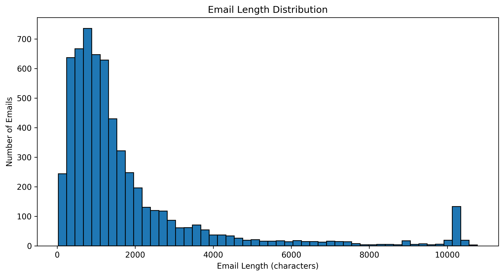

**Tên file:** `email_length_distribution.png`

**Ý nghĩa biểu đồ:** Biểu đồ thể hiện độ dài nội dung email trong tập dữ liệu. Giúp quan sát email thường ngắn hay dài, đồng thời phát hiện các email có độ dài bất thường.

**Cách đọc:** Quan sát các trục, nhãn, chú giải và sự khác biệt giữa các giá trị trên biểu đồ để rút ra nhận xét phù hợp.

#### Phân bố nhãn Spam và Ham

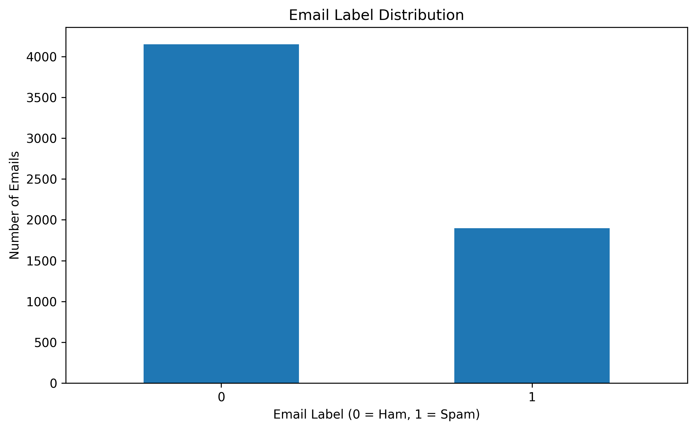

**Tên file:** `label_distribution.png`

**Ý nghĩa biểu đồ:** Biểu đồ thể hiện số lượng email thuộc từng lớp. Dùng để kiểm tra mức độ cân bằng giữa hai lớp dữ liệu. Nếu số lượng hai lớp chênh lệch lớn, mô hình có thể thiên lệch về lớp chiếm đa số.

**Cách đọc:** Quan sát các trục, nhãn, chú giải và sự khác biệt giữa các giá trị trên biểu đồ để rút ra nhận xét phù hợp.

#### Kiểm tra dữ liệu thiếu

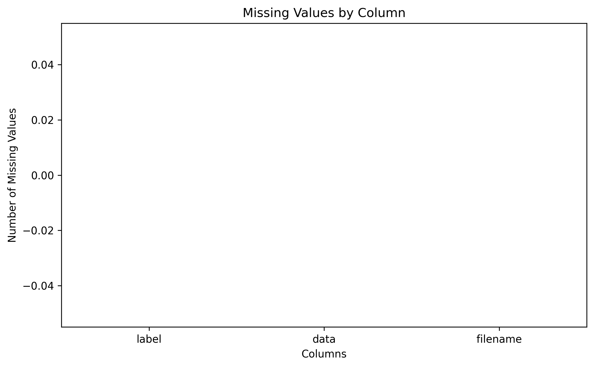

**Tên file:** `missing_values.png`

**Ý nghĩa biểu đồ:** Biểu đồ thể hiện số lượng giá trị thiếu trong từng cột. Mục đích là xác định dữ liệu cần xử lý trước khi đưa vào các bước tiếp theo.

**Cách đọc:** Quan sát các trục, nhãn, chú giải và sự khác biệt giữa các giá trị trên biểu đồ để rút ra nhận xét phù hợp.

### 7.2. Preprocessing

Làm sạch dữ liệu email và chuyển nội dung văn bản thành dạng số để các thuật toán Machine Learning có thể xử lý.

#### So sánh dữ liệu trước và sau làm sạch


**Tên file:** `cleaning_comparison.png`

**Ý nghĩa biểu đồ:** Biểu đồ so sánh số lượng dữ liệu trước và sau quá trình làm sạch. Qua đó đánh giá ảnh hưởng của các thao tác xử lý dữ liệu.

**Cách đọc:** Quan sát các trục, nhãn, chú giải và sự khác biệt giữa các giá trị trên biểu đồ để rút ra nhận xét phù hợp.

#### Các bước tiền xử lý dữ liệu

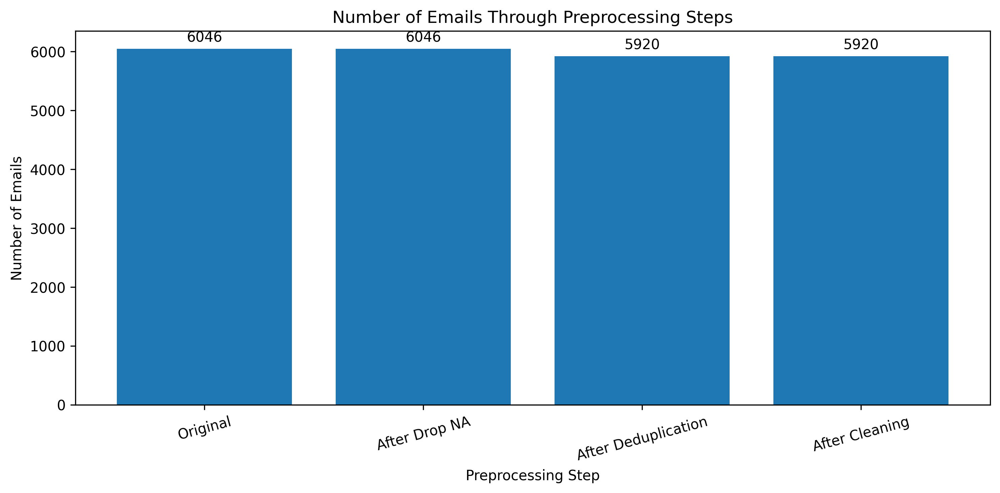

**Tên file:** `preprocessing_steps.png`

**Ý nghĩa biểu đồ:** Biểu đồ tóm tắt các thao tác tiền xử lý. Giúp theo dõi quá trình chuyển dữ liệu email thô thành dữ liệu phù hợp cho huấn luyện.

**Cách đọc:** Quan sát các trục, nhãn, chú giải và sự khác biệt giữa các giá trị trên biểu đồ để rút ra nhận xét phù hợp.

#### Độ thưa của ma trận TF-IDF

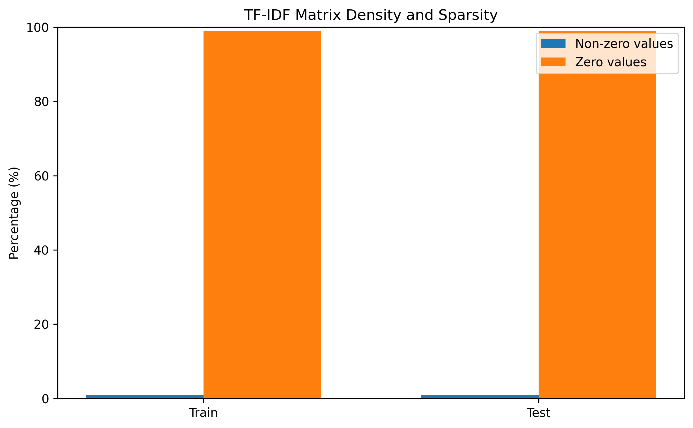

**Tên file:** `tfidf_sparsity.png`

**Ý nghĩa biểu đồ:** Biểu đồ thể hiện tỷ lệ phần tử khác 0 trong ma trận TF-IDF. Văn bản thường có nhiều đặc trưng bằng 0, do mỗi email chỉ chứa một phần nhỏ trong toàn bộ từ vựng của tập dữ liệu.

**Cách đọc:** Quan sát các trục, nhãn, chú giải và sự khác biệt giữa các giá trị trên biểu đồ để rút ra nhận xét phù hợp.

#### Các đặc trưng TF-IDF nổi bật

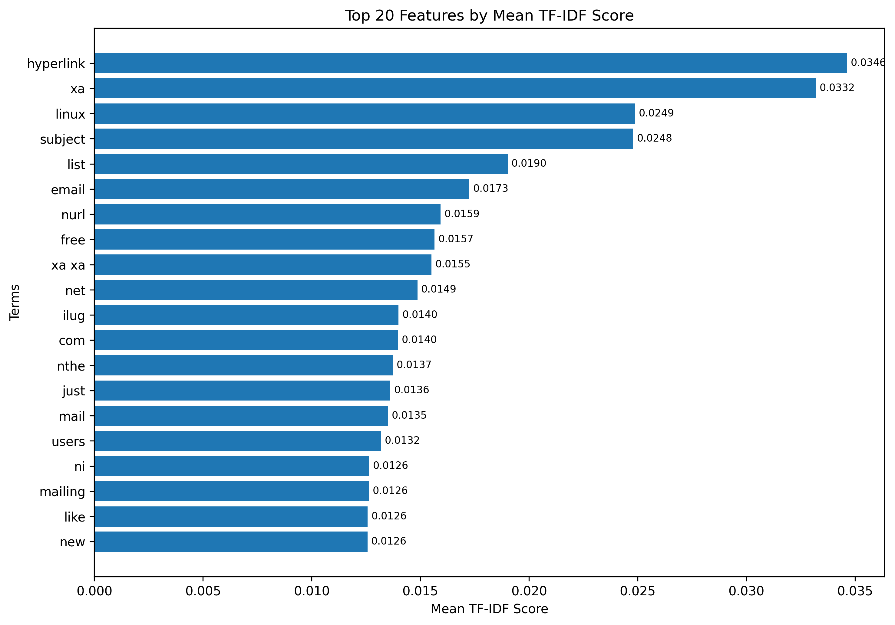

**Tên file:** `tfidf_top_features.png`

**Ý nghĩa biểu đồ:** Biểu đồ thể hiện những đặc trưng văn bản có giá trị TF-IDF nổi bật. Giúp quan sát các từ hoặc cụm từ được biểu diễn trong không gian đặc trưng.

**Cách đọc:** Quan sát các trục, nhãn, chú giải và sự khác biệt giữa các giá trị trên biểu đồ để rút ra nhận xét phù hợp.

#### Phân bố dữ liệu Train và Test

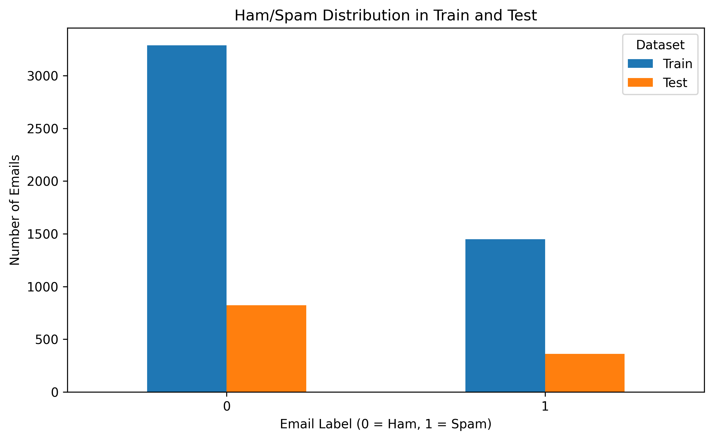

**Tên file:** `train_test_distribution.png`

**Ý nghĩa biểu đồ:** Biểu đồ so sánh phân bố nhãn giữa tập huấn luyện và tập kiểm tra. Mục đích là kiểm tra hai tập có phân bố tương đối nhất quán hay không.

**Cách đọc:** Quan sát các trục, nhãn, chú giải và sự khác biệt giữa các giá trị trên biểu đồ để rút ra nhận xét phù hợp.

### 7.3. Training

Xây dựng các mô hình phân loại email Spam và Ham từ dữ liệu huấn luyện đã được vector hóa.

#### Cấu hình huấn luyện

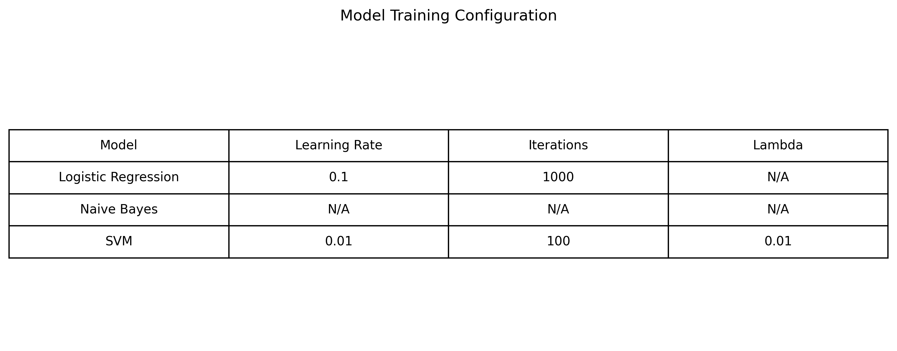

**Tên file:** `training_configuration.png`

**Ý nghĩa biểu đồ:** Biểu đồ thể hiện các cấu hình hoặc tham số được sử dụng trong quá trình huấn luyện mô hình.

**Cách đọc:** Quan sát các trục, nhãn, chú giải và sự khác biệt giữa các giá trị trên biểu đồ để rút ra nhận xét phù hợp.

#### Tổng quan dữ liệu huấn luyện

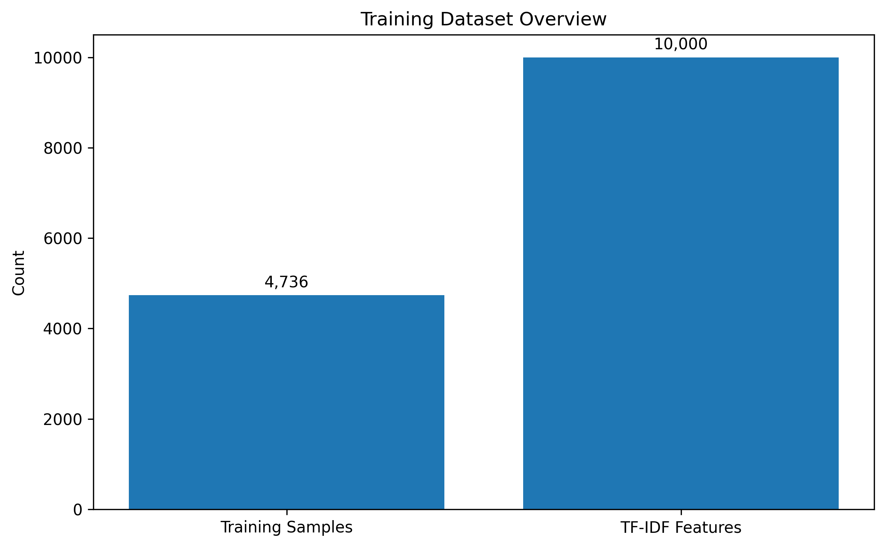

**Tên file:** `training_dataset_overview.png`

**Ý nghĩa biểu đồ:** Biểu đồ tóm tắt dữ liệu được sử dụng để huấn luyện các mô hình phân loại.

**Cách đọc:** Quan sát các trục, nhãn, chú giải và sự khác biệt giữa các giá trị trên biểu đồ để rút ra nhận xét phù hợp.

#### So sánh thời gian huấn luyện

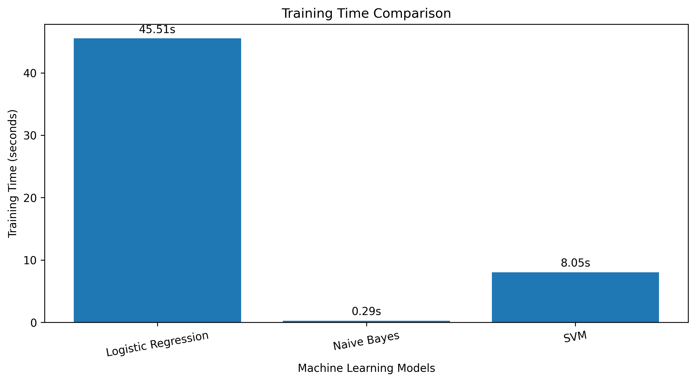

**Tên file:** `training_time_comparison.png`

**Ý nghĩa biểu đồ:** Biểu đồ so sánh thời gian huấn luyện giữa các mô hình. Giúp đánh giá chi phí tính toán của từng thuật toán.

**Cách đọc:** Quan sát các trục, nhãn, chú giải và sự khác biệt giữa các giá trị trên biểu đồ để rút ra nhận xét phù hợp.

### 7.4. Evaluation

Đánh giá khả năng phân loại của từng mô hình trên dữ liệu kiểm tra chưa được sử dụng để huấn luyện.

#### Confusion Matrix của các mô hình

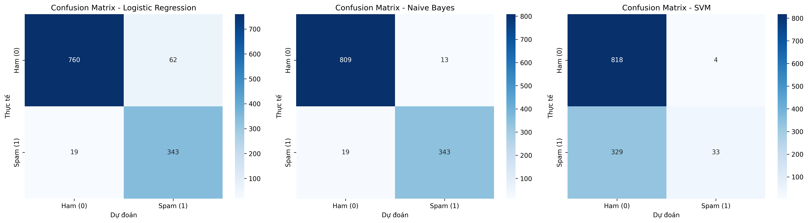

**Tên file:** `confusion_matrix_all.png`

**Ý nghĩa biểu đồ:** Ma trận nhầm lẫn tổng hợp số lượng dự đoán đúng và sai của các mô hình. Với bài toán Spam, cần chú ý False Positive và False Negative vì hai loại lỗi này có ý nghĩa khác nhau.

**Cách đọc:** Quan sát các trục, nhãn, chú giải và sự khác biệt giữa các giá trị trên biểu đồ để rút ra nhận xét phù hợp.

#### Confusion Matrix - Logistic Regression

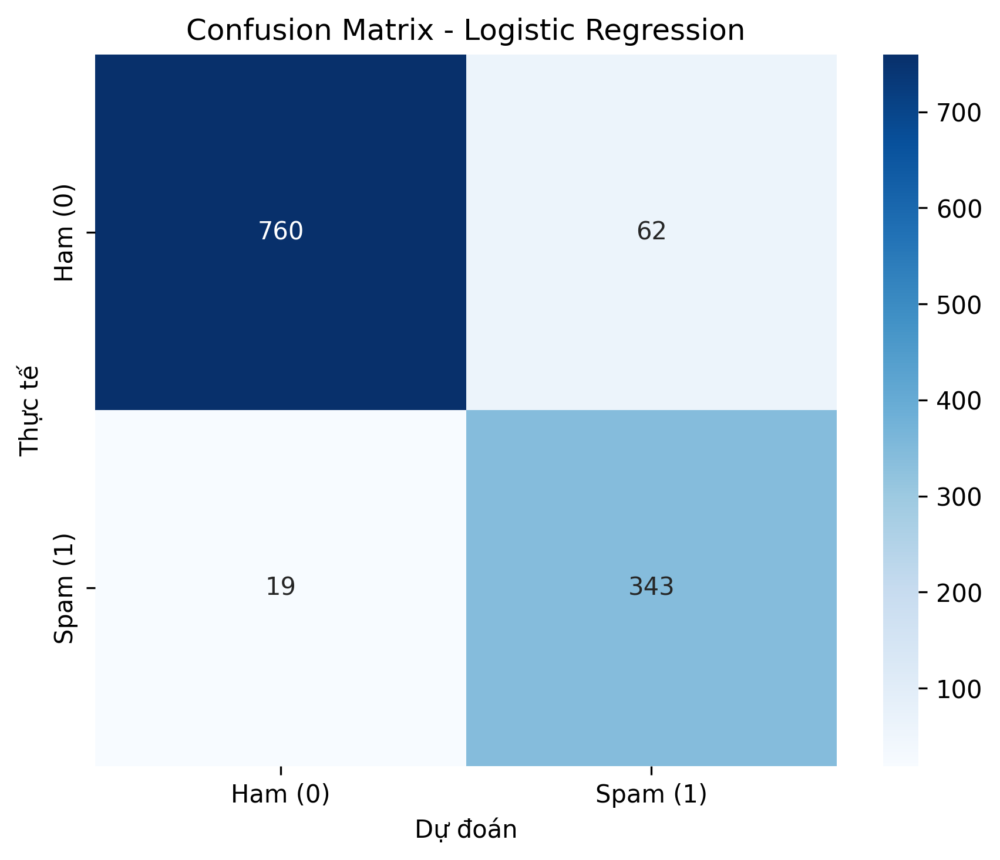

**Tên file:** `confusion_matrix_lr.png`

**Ý nghĩa biểu đồ:** Thể hiện số lượng dự đoán đúng và sai của Logistic Regression trên tập đánh giá.

**Cách đọc:** Quan sát các trục, nhãn, chú giải và sự khác biệt giữa các giá trị trên biểu đồ để rút ra nhận xét phù hợp.

#### Confusion Matrix - Naive Bayes

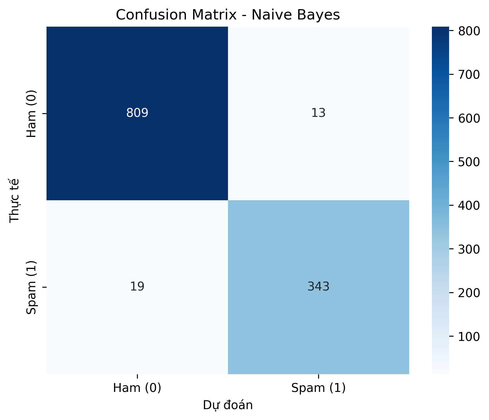

**Tên file:** `confusion_matrix_nb.png`

**Ý nghĩa biểu đồ:** Thể hiện số lượng dự đoán đúng và sai của Naive Bayes trên tập đánh giá.

**Cách đọc:** Quan sát các trục, nhãn, chú giải và sự khác biệt giữa các giá trị trên biểu đồ để rút ra nhận xét phù hợp.

#### Confusion Matrix - Support Vector Machine

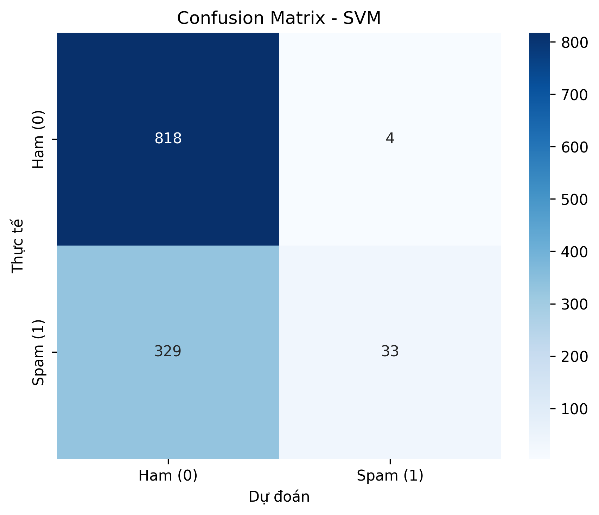

**Tên file:** `confusion_matrix_svm.png`

**Ý nghĩa biểu đồ:** Thể hiện số lượng dự đoán đúng và sai của SVM trên tập đánh giá.

**Cách đọc:** Quan sát các trục, nhãn, chú giải và sự khác biệt giữa các giá trị trên biểu đồ để rút ra nhận xét phù hợp.

#### So sánh các chỉ số đánh giá

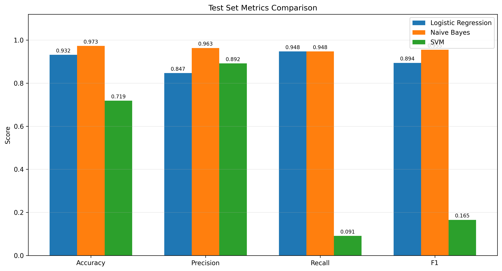

**Tên file:** `metrics_comparison.png`

**Ý nghĩa biểu đồ:** Biểu đồ so sánh các chỉ số như Accuracy, Precision, Recall và F1-score. Giúp nhận biết mô hình có hiệu quả phân loại tốt hơn theo từng tiêu chí.

**Cách đọc:** Quan sát các trục, nhãn, chú giải và sự khác biệt giữa các giá trị trên biểu đồ để rút ra nhận xét phù hợp.

#### Đường ROC của các mô hình

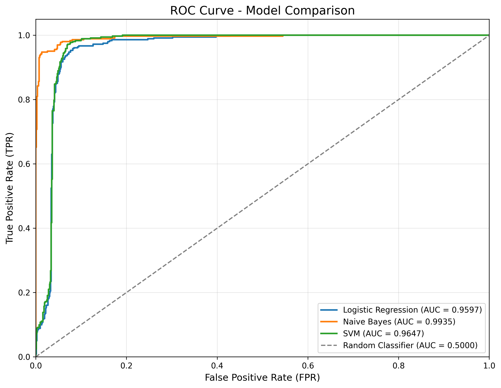

**Tên file:** `roc_curve_all.png`

**Ý nghĩa biểu đồ:** Đường ROC thể hiện mối quan hệ giữa TPR và FPR ở các ngưỡng phân loại khác nhau. AUC càng cao thì khả năng phân biệt hai lớp của mô hình càng tốt.

**Cách đọc:** Quan sát các trục, nhãn, chú giải và sự khác biệt giữa các giá trị trên biểu đồ để rút ra nhận xét phù hợp.

#### So sánh TPR và FPR

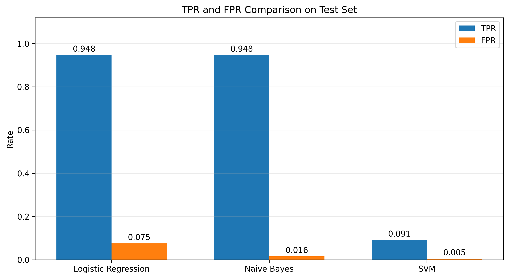

**Tên file:** `tpr_fpr_comparison.png`

**Ý nghĩa biểu đồ:** Biểu đồ so sánh tỷ lệ phát hiện đúng Spam và tỷ lệ nhận diện nhầm Ham thành Spam giữa các mô hình.

**Cách đọc:** Quan sát các trục, nhãn, chú giải và sự khác biệt giữa các giá trị trên biểu đồ để rút ra nhận xét phù hợp.

## 8. Nhật ký thực thi

Log ghi lại các thông tin trong quá trình Pipeline chạy, bao gồm các bước thực hiện, thời điểm và lỗi nếu có.

```text
[2026-11-05T01:37:38+07:00] [START] [PIPELINE] Bat dau quy trinh may hoc.
[2026-11-05T01:37:38+07:00] [START] [EDA] Bat dau buoc EDA.
[2026-11-05T01:37:38+07:00] [START] [EDA] Bat dau phan tich du lieu
[2026-11-05T01:37:39+07:00] [SUCCESS] [EDA] Hoan thanh EDA trong 0.5605 giay
[2026-11-05T01:37:39+07:00] [SUCCESS] [EDA] Hoan thanh trong 0.58 giay.
[2026-11-05T01:37:39+07:00] [START] [PREPROCESSING] Bat dau buoc PREPROCESSING.
[2026-11-05T01:37:39+07:00] [START] [PREPROCESSING] Bat dau tien xu ly du lieu
[2026-11-05T01:37:43+07:00] [SUCCESS] [PREPROCESSING] Hoan thanh tien xu ly trong 3.8277 giay
[2026-11-05T01:37:43+07:00] [SUCCESS] [PREPROCESSING] Hoan thanh trong 3.85 giay.
[2026-11-05T01:37:43+07:00] [START] [TRAINING] Bat dau buoc TRAINING.
[2026-11-05T01:37:43+07:00] [START] [TRAINING] Bat dau huan luyen mo hinh
[2026-11-05T01:38:28+07:00] [SUCCESS] [TRAINING - Logistic Regression] Training completed in 45.51 seconds
[2026-11-05T01:38:29+07:00] [SUCCESS] [TRAINING - Naive Bayes] Training completed in 0.29 seconds
[2026-11-05T01:38:37+07:00] [SUCCESS] [TRAINING - SVM] Training completed in 8.05 seconds
[2026-11-05T01:38:37+07:00] [SUCCESS] [TRAINING] Hoan thanh training trong 54.3011 giay
[2026-11-05T01:38:37+07:00] [SUCCESS] [TRAINING] Hoan thanh trong 54.34 giay.
[2026-11-05T01:38:37+07:00] [START] [EVALUATION] Bat dau buoc EVALUATION.
[2026-11-05T01:38:37+07:00] [START] [EVALUATION] Bat dau danh gia cac mo hinh.
[2026-11-05T01:38:37+07:00] [SUCCESS] [EVALUATION - Logistic Regression - Train] Danh gia Logistic Regression tren Train hoan tat. F1=0.9262, AUC=0.9716
[2026-11-05T01:38:37+07:00] [SUCCESS] [EVALUATION - Logistic Regression - Test] Danh gia Logistic Regression tren Test hoan tat. F1=0.8944, AUC=0.9597
[2026-11-05T01:38:38+07:00] [SUCCESS] [EVALUATION - Naive Bayes - Train] Danh gia Naive Bayes tren Train hoan tat. F1=0.9938, AUC=1.0000
[2026-11-05T01:38:38+07:00] [SUCCESS] [EVALUATION - Naive Bayes - Test] Danh gia Naive Bayes tren Test hoan tat. F1=0.9554, AUC=0.9935
[2026-11-05T01:38:38+07:00] [SUCCESS] [EVALUATION - SVM - Train] Danh gia SVM tren Train hoan tat. F1=0.1699, AUC=0.9748
[2026-11-05T01:38:39+07:00] [SUCCESS] [EVALUATION - SVM - Test] Danh gia SVM tren Test hoan tat. F1=0.1654, AUC=0.9647
[2026-11-05T01:38:40+07:00] [SUCCESS] [EVALUATION] Danh gia hoan tat trong 3.24 giay.
[2026-11-05T01:38:40+07:00] [SUCCESS] [EVALUATION] Hoan thanh trong 3.26 giay.
[2026-11-05T01:38:40+07:00] [SUCCESS] [PIPELINE] Hoan thanh toan bo quy trinh trong 62.03 giay.

```

---

Báo cáo được tạo tự động từ dữ liệu tracking, metrics, biểu đồ và log của Lab01.